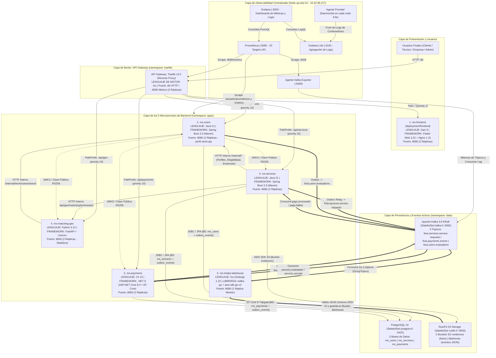
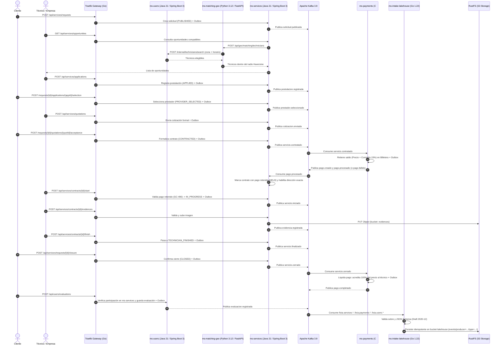

# Diseño de Alto Nivel (HLD) — Arquitectura e Infraestructura de Fixia

Este documento presenta el **Diseño de Alto Nivel (HLD)** de la **Arquitectura Lógica de Software** y de la **Distribución Física en Clústeres Kubernetes (K3s)** de **Fixia** en el ambiente de QA, especificando de manera explícita el **lenguaje de programación**, **framework** y **rol exacto** de cada componente para evitar ambigüedades al generar diagramas o imágenes.

---

## 0. Catálogo Oficial de Microservicios y Lenguajes de Programación (Únicos 6 Componentes de Aplicación)

> [!IMPORTANT]
> **Fixia cuenta exclusivamente con 6 componentes de aplicación** (`1 Frontend SPA + 5 Microservicios de Backend`) desplegados en el namespace `apps`:
> - **NO existen otros microservicios de negocio.**
> - `ms-orchestrator` **NO es un microservicio en ejecución**: es únicamente el repositorio de **Infraestructura como Código (Ansible + Manifiestos Kubernetes)**.
> - `traefik` es el **API Gateway / Ingress Controller** (infraestructura de borde).
> - `kafka-exporter` y `promtail` son **agentes recolectores de observabilidad** (no microservicios de negocio).
> - `vault-0` y `mongodb-0` son pods de infraestructura base aprovisionados en el clúster pero **no son consumidos por ningún microservicio de Fixia**.

| # | Nombre del Componente | Tipo | Lenguaje de Programación | Framework / Runtime | Logo Oficial Recomendado | Puerto / Réplicas | Base de Datos / Almacenamiento |
| :-: | :--- | :--- | :--- | :--- | :--- | :---: | :--- |
| **1** | **`ms-frontend`** (`deployment/frontend`) | Frontend Web SPA | **Dart 3** | **Flutter Web 3.22** (servido por **Nginx 1.31 Alpine**) | **Flutter / Dart + Nginx** | `:8080` (2 réplicas) | N/A (Consume APIs REST vía Traefik) |
| **2** | **`ms-users`** (`deployment/ms-users`) | Microservicio Backend | **Java 21 (OpenJDK 21)** | **Spring Boot 3.3** (Maven, Spring Security, JPA) | **Java + Spring Boot** | `:8080` (2 réplicas) | PostgreSQL 16 (`ms_users`) + Kafka (`fixia.users.evaluations`) |
| **3** | **`ms-services`** (`deployment/ms-services`) | Microservicio Backend | **Java 21 (OpenJDK 21)** | **Spring Boot 3.3** (Maven, JPA, AWS SDK S3) | **Java + Spring Boot** | `:8080` (2 réplicas) | PostgreSQL 16 (`ms_services`) + RustFS S3 (`evidences`) + Kafka (`fixia.services.service-requests`) |
| **4** | **`ms-matching-geo`** (`deployment/ms-matching-geo`) | Microservicio Backend | **Python 3.12** | **FastAPI** + **Uvicorn** + **Pydantic v2** + **httpx** | **Python + FastAPI** | `:8000` (2 réplicas) | Stateless (Consulta `ms-users` por HTTP interno) |
| **5** | **`ms-payments`** (`deployment/ms-payments`) | Microservicio Backend | **C# 12** | **.NET 8 (ASP.NET Core 8.0 Web API + EF Core 8)** | **C# / .NET 8** | `:8080` (2 réplicas) | PostgreSQL 16 (`ms_payments`) + Kafka (`fixia.payments.events`) |
| **6** | **`ms-intake-lakehouse`** (`deployment/ms-intake-lakehouse`) | Microservicio Worker | **Go (Golang) 1.22** | **Go Standard Library (`net/http`) + `kafka-go` + `aws-sdk-go-v2`** | **Go (Golang Gopher)** | `:8080` (1 réplica) | Consume los 3 tópicos de Kafka + escribe en RustFS S3 (`lakehouse`) |

---

## 1. HLD de Arquitectura Lógica (Con Lenguajes y Frameworks Explícitos)

---

## 2. HLD de Infraestructura y Distribución Física por Nodos y Pods (Clúster K3s QA)

```mermaid
flowchart LR
    subgraph GitHub["GitHub Cloud & GHCR"]
        GHA["GitHub Actions CI (Build & Test en rama Qa)"]
        GHCR["GitHub Container Registry (ghcr.io/grupo-fixia/*)"]
        GHA -->|"Push Docker Image"| GHCR
    end

    subgraph NodoCoord["Nodo Coordinador y Observabilidad: qa-obs-01 / nbig23 (10.43.98.217)"]
        ANS["ms-orchestrator: Playbooks Ansible (IaC - No es un microservicio)"]
        RUNNER["GitHub Self-Hosted Runner (Workflow CD)"]
        subgraph K3sObs["Clúster K3s Observabilidad (namespace: observability)"]
            P_PROM["Pod: prometheus (:9090)"]
            P_LOKI["StatefulSet: loki-0 (:3100)"]
            P_GRAF["Pod: grafana (:3000)"]
            P_PROMT0["DaemonSet: promtail (local)"]
        end
    end

    subgraph ClusterQA["Clúster K3s Principal de QA (Red 10.43.98.0/23 - Flannel VXLAN 10.244.0.0/16)"]
        subgraph Node1["qa-k3s-01 / nbig17 (10.43.98.211) — Control Plane & Worker (10.244.0.0/24)"]
            API["K3s Control Plane (:6443), CoreDNS, Local-Path, Metrics-Server & ServiceLB (x5)"]
            T1["Pod Gateway: traefik-7bbb4dc5c-h845r (10.244.0.46) — Réplica 1/2"]
            S1["Pod [JAVA 21 / SPRING BOOT 3]: ms-services-5f58c77b65-ch77f (10.244.0.52) — Réplica 1/2"]
            KF0["StatefulSet Broker: kafka-0 (10.244.0.15 | PVC data-kafka-0 8Gi)"]
            PROMT1["Agente Logs: promtail-2lst2 (10.244.0.20)"]
        end

        subgraph Node2["qa-k3s-02 / nbig59 (10.43.98.253) — Worker 1 (10.244.1.0/24)"]
            FE1["Pod [DART / FLUTTER WEB + NGINX]: frontend-d5df9cfdc-r8p6g (10.244.1.44) — Réplica 1/2"]
            U1["Pod [JAVA 21 / SPRING BOOT 3]: ms-users-866d86db84-mbm9h (10.244.1.50 | seed-qa) — Réplica 1/2"]
            S2["Pod [JAVA 21 / SPRING BOOT 3]: ms-services-5f58c77b65-rszs2 (10.244.1.52) — Réplica 2/2"]
            P1["Pod [C# 12 / .NET 8]: ms-payments-6496744d9d-2md54 (10.244.1.51) — Réplica 1/2"]
            G1["Pod [PYTHON 3.12 / FASTAPI]: ms-matching-geo-576ddfd96d-ks4tq (10.244.1.43) — Réplica 1/2"]
            L1["Pod [GO / GOLANG 1.22]: ms-intake-lakehouse-7bddb8cd86-26bbv (10.244.1.53) — Réplica 1/1"]
            PG0["StatefulSet BD: postgres-0 (10.244.1.6 | PVC data-postgres-0 5Gi)"]
            KE["Agente Métricas: kafka-exporter-64d9bc5547-knnp4 (10.244.1.16)"]
            PROMT2["Agente Logs: promtail-b6dhn (10.244.1.14) & ServiceLB (x5)"]
        end

        subgraph Node3["qa-k3s-03 / nbig65 (10.43.99.6) — Worker 2 (10.244.3.0/24)"]
            T2["Pod Gateway: traefik-7bbb4dc5c-9h8rl (10.244.3.50) — Réplica 2/2"]
            FE2["Pod [DART / FLUTTER WEB + NGINX]: frontend-d5df9cfdc-rn49z (10.244.3.48) — Réplica 2/2"]
            U2["Pod [JAVA 21 / SPRING BOOT 3]: ms-users-866d86db84-jc4b9 (10.244.3.55 | seed-qa) — Réplica 2/2"]
            P2["Pod [C# 12 / .NET 8]: ms-payments-6496744d9d-d6wlc (10.244.3.56) — Réplica 2/2"]
            G2["Pod [PYTHON 3.12 / FASTAPI]: ms-matching-geo-576ddfd96d-8wgql (10.244.3.47) — Réplica 2/2"]
            RFS0["StatefulSet S3: rustfs-0 (10.244.3.37 | PVC data-rustfs-0 5Gi) + Job rustfs-init"]
            UNUSED["Infraestructura Base sin uso activo: vault-0 (1Gi) & mongodb-0 (5Gi)"]
            PROMT3["Agente Logs: promtail-qn985 (10.244.3.18) & ServiceLB (x5)"]
        end
    end

    %% Relaciones de Despliegue y Monitoreo
    ANS -->|"Aprovisiona K3s, Datos, Secretos y Observabilidad (SSH)"| ClusterQA
    RUNNER -->|"kubectl apply & rollout (KUBECONFIG)"| API
    ClusterQA -->|"Pull con secret/ghcr-pull"| GHCR
    P_PROM -->|"Scrape Métricas (:9100-:9104, :9108, :9180, :10250)"| ClusterQA
    PROMT1 & PROMT2 & PROMT3 -->|"Envío de Logs HTTP :3100"| P_LOKI
```

---

## 3. Flujo Transaccional y Coreografía de Eventos (Outbox + Kafka + Lakehouse)

