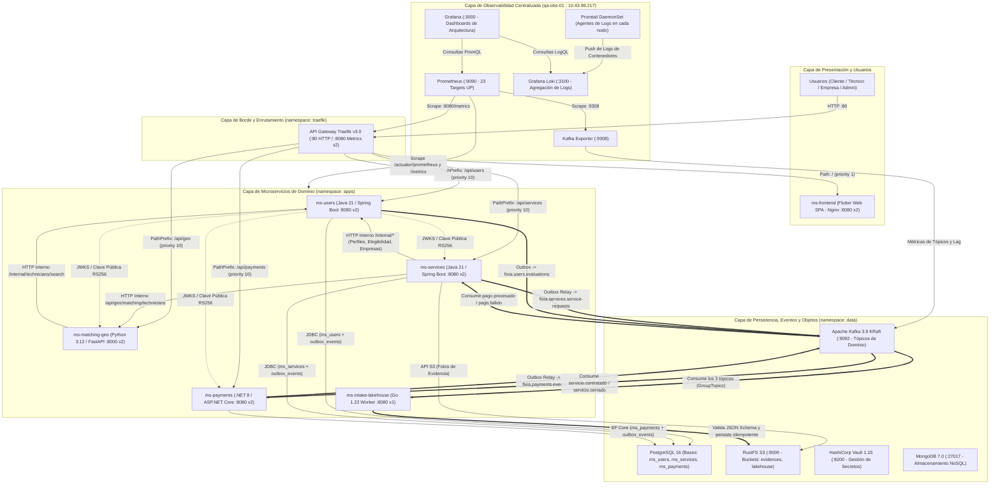
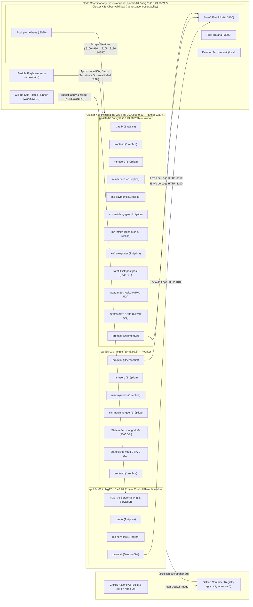
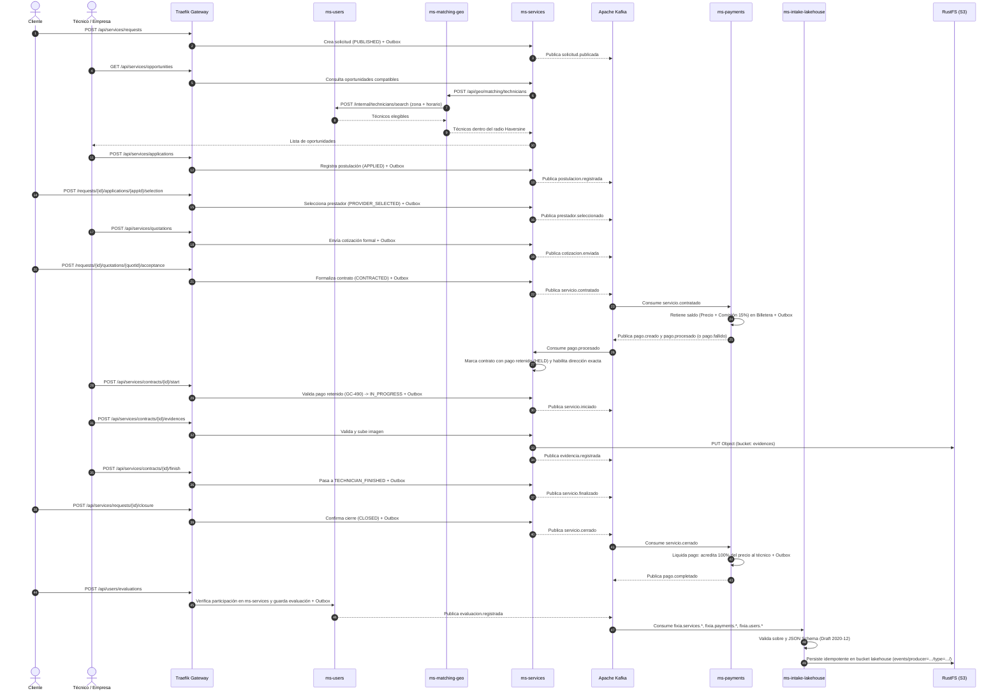

# Diseño de Alto Nivel (HLD) — Arquitectura e Infraestructura de Fixia

Este documento presenta los diagramas de **Alto Nivel (HLD)** tanto de la **Arquitectura Lógica de Software y Datos** como de la **Infraestructura Física / Clústeres Kubernetes (K3s)** desplegados en el ambiente de QA.

---

## 1. HLD de Arquitectura Lógica (Microservicios, Datos, Mensajería y Observabilidad)

---

## 2. HLD de Infraestructura y Topología de Clústeres (Despliegue en QA)

---

## 3. Flujo Transaccional y Coreografía de Eventos (Outbox + Kafka + Lakehouse)

---

## 4. Resumen de Componentes de la Arquitectura

| Capa | Componente | Tecnología | Réplicas / Tipo | Responsabilidad Principal |
| :--- | :--- | :--- | :---: | :--- |
| **Borde** | `traefik` | Traefik v3.0 | 2 (`Deployment`) | Enrutamiento HTTP (`:80`), prioridades por prefijo (`/api/*` vs `/`) y métricas (`:8080`). |
| **Presentación** | `frontend` | Flutter Web 3.22 + Nginx | 2 (`Deployment`) | SPA multi-rol (Cliente, Técnico, Empresa) servida sin caché de Service Worker. |
| **Dominio** | `ms-users` | Java 21 / Spring Boot 3 | 2 (`Deployment`) | Autenticación JWT (RS256), perfiles, zonas, horarios, empresas (`seed-qa`), evaluaciones y reputación. |
| **Dominio** | `ms-services` | Java 21 / Spring Boot 3 | 2 (`Deployment`) | Solicitudes, oportunidades, postulaciones, cotizaciones, contratos, evidencias S3 y Outbox Relay. |
| **Dominio** | `ms-matching-geo` | Python 3.12 / FastAPI | 2 (`Deployment`) | Emparejamiento geoespacial (Haversine) y filtro horario coordinado con `ms-users`. |
| **Dominio** | `ms-payments` | C# / .NET 8 ASP.NET Core | 2 (`Deployment`) | Billetera digital, recargas, retiros, comisiones (15%), retención/liquidación por Kafka y reembolsos Admin. |
| **Analítica** | `ms-intake-lakehouse` | Go 1.22 | 1 (`Deployment`) | Consumidor multi-tópico de Kafka con validación JSON Schema 2020-12 e ingesta idempotente en S3 (`lakehouse`). |
| **Datos** | `postgres-0` | PostgreSQL 16 | 1 (`StatefulSet`) | Persistencia relacional transaccional (`ms_users`, `ms_services`, `ms_payments`) y tablas `outbox_events`. |
| **Mensajería** | `kafka-0` | Apache Kafka 3.9 (KRaft) | 1 (`StatefulSet`) | Bus de eventos (`fixia.services.service-requests`, `fixia.payments.events`, `fixia.users.evaluations`). |
| **Objetos S3** | `rustfs-0` | RustFS (API S3) | 1 (`StatefulSet`) | Almacenamiento de objetos compatible con S3 para fotos de evidencia (`evidences`) y Data Lakehouse (`lakehouse`). |
| **Secretos / NoSQL** | `vault-0` / `mongodb-0` | Vault 1.15 / MongoDB 7.0 | 1 c/u (`StatefulSet`) | Gestión de secretos e infraestructura documental aprovisionada en la capa de datos. |
| **Observabilidad** | `prometheus` / `loki` / `grafana` | Stack Grafana / Prometheus | Nodo `qa-obs-01` | Monitoreo de 23 targets (cAdvisor, Kubelet, Spring Actuator, .NET, Traefik, Kafka) y logs centralizados vía Promtail. |

