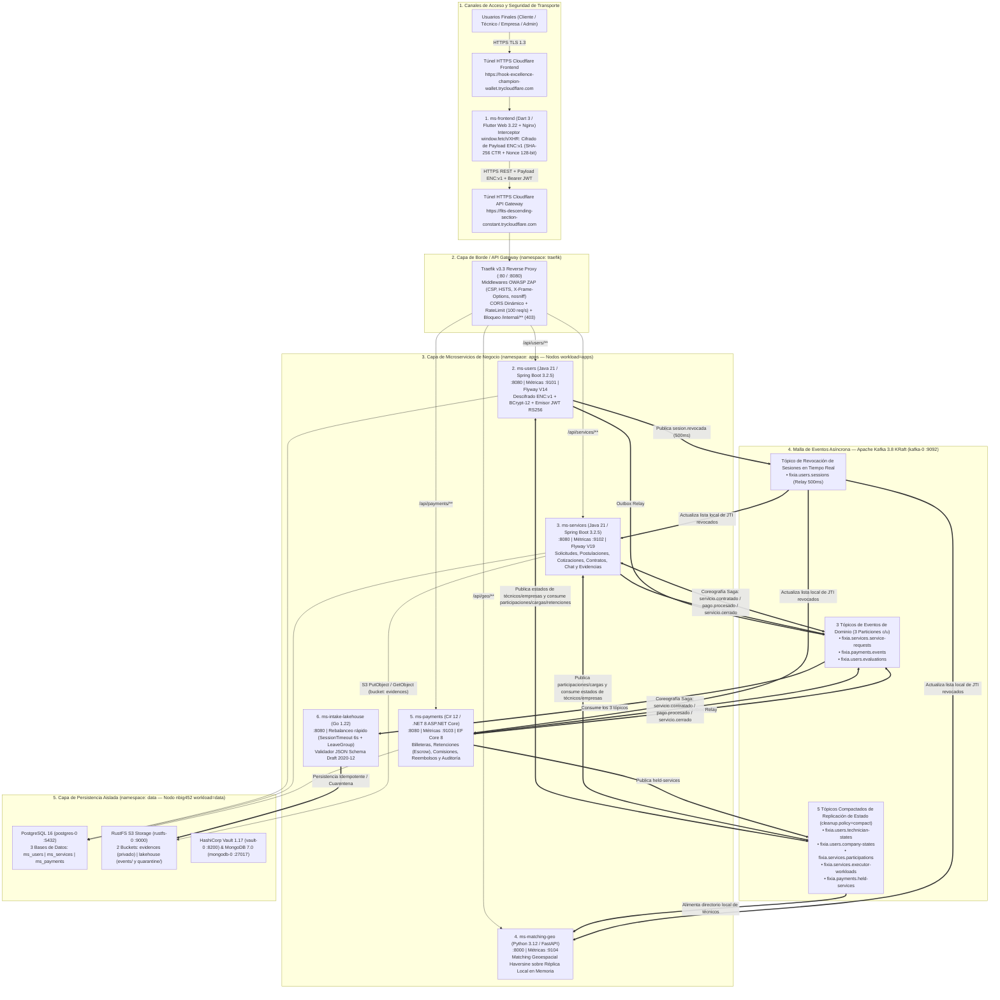
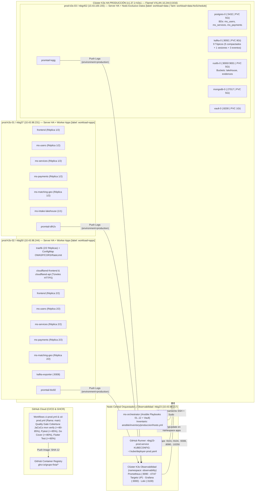

# Diseño de Alto Nivel (HLD) — Arquitectura e Infraestructura Multi-Ambiente (Producción, QA y Observabilidad) de Fixia

> **Última Actualización:** 2026-11-24  
> **Ambientes Activos:** **Producción** (Clúster K3s HA con Aislamiento Físico Apps/Data + Túneles Cloudflare HTTPS), **QA** (Clúster K3s HA) y **Nodo Central de Orquestación y Observabilidad** (`10.43.98.217` / `nbig23`).  
> **Arquitectura de Comunicación:** **Cero Dependencias HTTP Síncronas entre Microservicios (`GC-547`)** — Replicación de estado mediante 5 tópicos compactados en Apache Kafka (`cleanup.policy=compact`), lista local de sesiones revocadas (`fixia.users.sessions`) y Patrón Transactional Outbox hacia el Data Lakehouse (`RustFS S3`).

---

## 0. Catálogo Oficial de Microservicios y Lenguajes de Programación (6 Componentes de Aplicación)

> [!IMPORTANT]
> **Fixia cuenta exclusivamente con 6 componentes de aplicación** (`1 Frontend SPA + 5 Microservicios de Backend`) desplegados en el namespace `apps`:
> - **`ms-orchestrator`** **NO es un microservicio en ejecución**: es el repositorio de **Infraestructura como Código (Ansible + Vault + Manifiestos Kubernetes + Docker Compose)**.
> - **`traefik`** es el **API Gateway / Ingress Controller** (infraestructura de borde en el namespace `traefik`, con middlewares OWASP ZAP, CORS, Rate Limiting y bloqueo de `/internal/**`).
> - **`cloudflared-frontend`** y **`cloudflared-api`** son los conectores Zero-Trust de Cloudflare que exponen el Frontend y el API Gateway de Producción por HTTPS (`TLS 1.3`).
> - **`kafka-exporter`** (`:9308`) y **`promtail`** (DaemonSet) son agentes recolectores de observabilidad que reportan al clúster central en `10.43.98.217`.

| # | Componente (`namespace: apps`) | Tipo | Lenguaje / Runtime | Framework y Librerías Clave | Puertos (App / Métricas) | Réplicas (QA / Prod) | Persistencia y Tópicos Kafka |
| :-: | :--- | :--- | :--- | :--- | :---: | :---: | :--- |
| **1** | **`ms-frontend`** (`deployment/frontend`) | Frontend Web SPA | **Dart 3.4** | **Flutter Web 3.22** + **Nginx 1.27 Alpine** (Cabeceras OWASP + Interceptor `window.fetch`/XHR con cifrado `ENC:v1`) | `:8080` (Service `:80`) | `2 / 2` | Stateless (Consume el API Gateway por HTTPS en Prod y HTTP en QA) |
| **2** | **`ms-users`** (`deployment/ms-users`) | Microservicio Backend | **Java 21 LTS (OpenJDK 21)** | **Spring Boot 3.2.5**, Spring Security OAuth2 JWT (RS256), BCrypt costo 12, `CredentialCipher` (`ENC:v1`), JPA, Flyway (`V14`), Micrometer | `:8080` / `:9101` (`/actuator/prometheus`) | `2 / 2` | **PostgreSQL 16 (`ms_users`)**. **Produce:** `fixia.users.evaluations`, `fixia.users.technician-states` (compact), `fixia.users.company-states` (compact), `fixia.users.sessions`. **Consume:** `fixia.services.participations`, `fixia.services.executor-workloads`, `fixia.payments.held-services`. |
| **3** | **`ms-services`** (`deployment/ms-services`) | Microservicio Backend | **Java 21 LTS (OpenJDK 21)** | **Spring Boot 3.2.5**, JPA, Flyway (`V19`), AWS SDK S3 v2 (`evidences`, `max-swallow-size: -1`), Spring Kafka, Micrometer | `:8080` / `:9102` (`/actuator/prometheus`) | `2 / 2` | **PostgreSQL 16 (`ms_services`)** + **RustFS S3 (`evidences`)**. **Produce:** `fixia.services.service-requests`, `fixia.services.participations` (compact), `fixia.services.executor-workloads` (compact). **Consume:** `fixia.payments.events`, `fixia.users.technician-states`, `fixia.users.company-states`, `fixia.users.sessions`. |
| **4** | **`ms-matching-geo`** (`deployment/ms-matching-geo`) | Microservicio Backend | **Python 3.12** | **FastAPI 0.111**, Uvicorn, `confluent-kafka 2.6.1`, PyJWT (RS256), Middleware Prometheus nativo | `:8000` / `:9104` (`/actuator/prometheus`, `/metrics`) | `2 / 2` | **In-Memory State Replica (Stateless)**. **Consume:** `fixia.users.technician-states` (directorio local de técnicos) y `fixia.users.sessions` (lista local de tokens revocados). |
| **5** | **`ms-payments`** (`deployment/ms-payments`) | Microservicio Backend | **C# 12 / .NET 8.0** | **ASP.NET Core 8.0 Web API**, EF Core 8, Npgsql, `Confluent.Kafka`, `PrometheusMetricsMiddleware` | `:8080` / `:9103` (`/actuator/prometheus`, `/metrics`) | `2 / 2` | **PostgreSQL 16 (`ms_payments`)**. **Produce:** `fixia.payments.events`, `fixia.payments.held-services` (compact). **Consume:** `fixia.services.service-requests`, `fixia.users.sessions`. |
| **6** | **`ms-intake-lakehouse`** (`deployment/ms-intake-lakehouse`) | Microservicio Worker | **Go (Golang) 1.22** | `segmentio/kafka-go` (`SessionTimeout: 6s`, `LeaveGroup` limpio), `minio-go/v7`, `santhosh-tekuri/jsonschema/v5` (Draft 2020-12) | `:8080` (`/health`, `/metrics`) | `1 / 1` | **RustFS S3 (`lakehouse`)**. **Consume:** `fixia.services.service-requests`, `fixia.payments.events`, `fixia.users.evaluations`. Escribe en `events/` o `quarantine/`. |

---

## 1. Topología General Multi-Ambiente (Red LAN Institucional `10.43.98.0/22`)

Todos los **7 servidores Linux (Ubuntu 22.04.5 LTS)** conviven bajo la misma red institucional y son gobernados centralmente por el nodo **`nbig23` (`10.43.98.217`)**, que actúa simultáneamente como **Orquestador Ansible**, **Coordinador de Runners CI/CD (`nbig23-qa` y `nbig23-prod`)** y **Clúster de Observabilidad Central (`47/47 Targets UP`)**.

| Ambiente | Hostname | Nombre Inventario | Dirección IP | Rol en Kubernetes (K3s) | Etiquetas / Taints de Carga | Cargas Alojadas |
| :--- | :--- | :--- | :---: | :--- | :--- | :--- |
| **Orquestación & Observabilidad** | **`nbig23`** | `qa-obs-01` | `10.43.98.217` | K3s Single-Node (`observability`) + Ansible + GitHub Runners | `node-role.kubernetes.io/control-plane` | `prometheus` (`:9090`), `grafana` (`:3000`), `loki-0` (`:3100`), `promtail`, Runners `nbig23-qa` y `nbig23-prod` |
| **PRODUCCIÓN** | **`nbig37`** | `prod-k3s-01` (`produccion_1`) | `10.43.98.231` | K3s Server HA (`control-plane,etcd`) + App Worker 1 | `workload=apps` | Réplica 1 de `frontend`, `ms-users`, `ms-services`, `ms-payments`, `ms-matching-geo`, `ms-intake-lakehouse`, `promtail` |
| **PRODUCCIÓN** | **`nbig50`** | `prod-k3s-02` (`produccion_2`) | `10.43.98.244` | K3s Server HA (`control-plane,etcd`) + App Worker 2 | `workload=apps` | Réplica 2 de `frontend`, `ms-users`, `ms-services`, `ms-payments`, `ms-matching-geo`, `traefik` (x2), `cloudflared-frontend`, `cloudflared-api`, `kafka-exporter`, `promtail` |
| **PRODUCCIÓN** | **`nbig452`** | `prod-k3s-03` (`produccion_3`) | `10.43.100.155` | K3s Server HA (`control-plane,etcd`) + **Data Node Exclusivo** | `workload=data` + **Taint `workload=data:NoSchedule`** | **Exclusivo Capa de Datos (`namespace: data`):** `postgres-0` (5Gi), `kafka-0` (8Gi), `rustfs-0` (5Gi), `mongodb-0` (5Gi), `vault-0` (1Gi), `promtail` |
| **QA** | **`nbig17`** | `qa-k3s-01` | `10.43.98.211` | K3s Server HA (`control-plane,etcd`) + Worker Mixto 1 | Mixto (`apps` + `data`) | `kafka-0`, `traefik`, pods de `apps`, `promtail` |
| **QA** | **`nbig59`** | `qa-k3s-02` | `10.43.98.253` | K3s Server HA (`control-plane,etcd`) + Worker Mixto 2 | Mixto (`apps` + `data`) | `postgres-0`, `kafka-exporter`, pods de `apps`, `promtail` |
| **QA** | **`nbig65`** | `qa-k3s-03` | `10.43.99.6` | K3s Server HA (`control-plane,etcd`) + Worker Mixto 3 | Mixto (`apps` + `data`) | `rustfs-0`, `mongodb-0`, `vault-0`, `traefik`, pods de `apps`, `promtail` |

---

## 2. HLD de Arquitectura Lógica y Malla de Eventos (Kafka State Replication + Outbox + Lakehouse)

---

## 3. HLD de Distribución Física del Clúster K3s de PRODUCCIÓN (Aislamiento Apps vs. Data)

