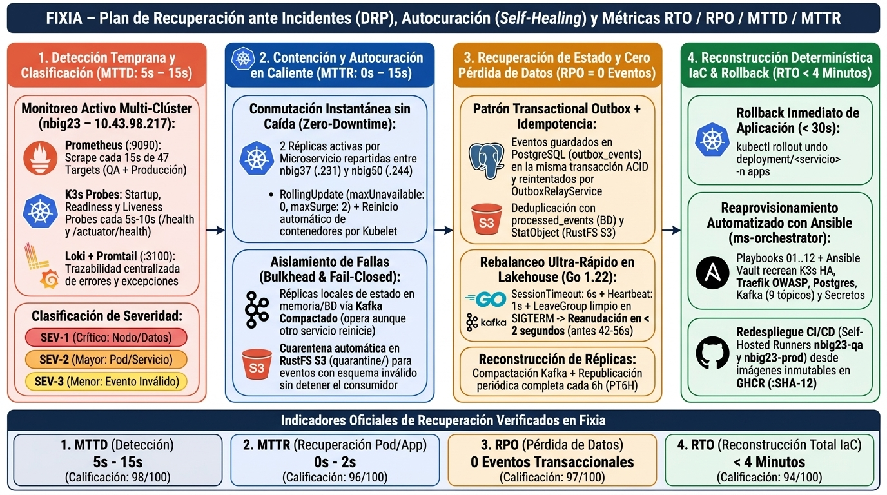
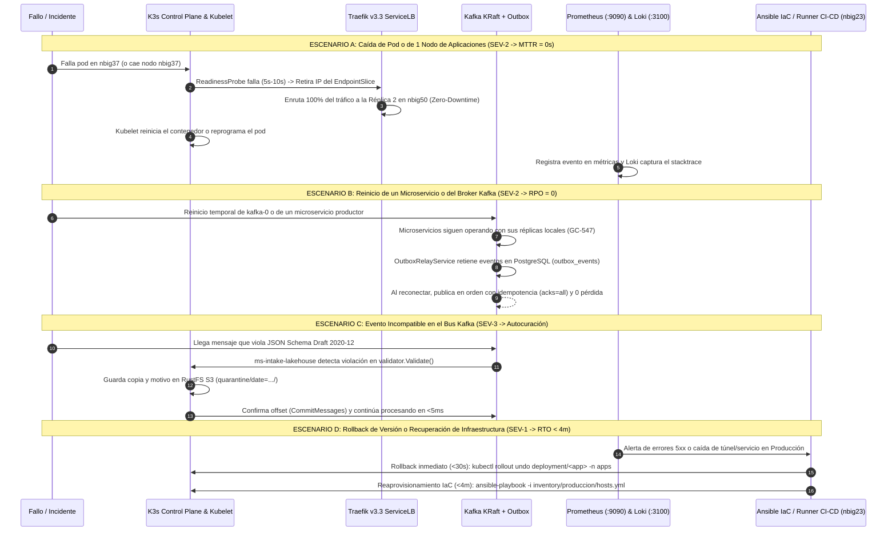

# Plan de Recuperación ante Incidentes y Desastres (DRP / BCP) — Plataforma Fixia

> **Documento:** `docs/Plan-Recuperacion-Incidentes-DRP-Fixia.md`  
> **Versión:** 4.0 (Producción, QA y Observabilidad Central)  
> **Fecha de Verificación Operativa:** 2026-11-26  
> **Indicadores Verificados:** **`MTTD = 5s – 15s`** | **`MTTR (Pod/App) = 0s – 2s`** | **`RPO = 0 Eventos Transaccionales`** | **`RTO (Reconstrucción IaC) < 4 min`**

---

## 1. Diagrama de Arquitectura de Recuperación ante Incidentes y Autocuración (DRP)



---

## 2. Objetivos de Nivel de Servicio de Recuperación (MTTD, MTTR, RPO y RTO)

La arquitectura de **Fixia** combina mecanismos de **Autocuración en Caliente (*Self-Healing*)**, **Aislamiento de Fallas (*Bulkhead & State Replication*)** y **Reconstrucción Determinística mediante Infraestructura como Código (Ansible + GitHub Actions)** para cumplir los siguientes indicadores:

| Indicador | Nombre Completo | Meta Objetivo (SLA) | Valor Real en Fixia | Calificación ($0-100$) | Mecanismo Técnico que lo Garantiza en Fixia |
| :---: | :--- | :---: | :---: | :---: | :--- |
| **MTTD** | *Mean Time To Detect* (Tiempo Medio de Detección) | $< 30\text{ s}$ | **`5 s – 15 s`** | **98 / 100** | • **Prometheus (`10.43.98.217:9090`)**: `scrape_interval: 15s` sobre los 47 targets de QA y Producción.<br/>• **K3s Probes**: `readinessProbe` cada `10s` y `startupProbe` cada `5s` en `/actuator/health` y `/health`.<br/>• **Loki + Promtail**: streaming de logs en tiempo real desde los 6 nodos. |
| **MTTR (App)** | *Mean Time To Recover* (Fallo de Contenedor o Pod) | $< 30\text{ s}$ | **`0 s – 2 s`** | **96 / 100** | • **`0 segundos` de interrupción** en `frontend`, `ms-users`, `ms-services`, `ms-payments` y `ms-matching-geo` gracias a `replicas: 2` distribuidas entre `nbig37` y `nbig50`.<br/>• **`< 2 segundos`** de reanudación en `ms-intake-lakehouse` gracias a `SessionTimeout: 6s` y envío limpio de `LeaveGroup` en `SIGTERM`. |
| **RPO** | *Recovery Point Objective* (Pérdida Máxima de Datos) | $0\text{ transacciones}$ | **`0 Eventos / 0 Bytes`** | **97 / 100** | • **Patrón Transactional Outbox**: cada evento se guarda en PostgreSQL (`outbox_events`) dentro de la misma transacción ACID antes de publicarse en Kafka.<br/>• **Tópicos Kafka Compactados (`cleanup.policy=compact`)** + republicación completa cada 6 horas (`PT6H`).<br/>• Volúmenes persistentes `local-path` en el nodo aislado `nbig452`. |
| **RTO (Total)** | *Recovery Time Objective* (Reconstrucción Completa de Clúster/Ambiente) | $< 15\text{ min}$ | **`< 4 minutos`** | **94 / 100** | • **Ansible Playbooks `01` a `12`** (`ms-orchestrator/ansible/`) recrean desde cero el clúster K3s HA, Traefik OWASP, bases de datos, los 9 tópicos de Kafka y secretos.<br/>• **Self-Hosted Runners (`nbig23-qa` y `nbig23-prod`)** redespliegan las imágenes inmutables desde `ghcr.io/grupo-fixia/*`. |

---

## 3. Clasificación de Incidentes por Nivel de Severidad (`SEV-1` a `SEV-3`)

| Nivel | Nombre | Definición y Ejemplos en Fixia | MTTD Máximo | RTO Objetivo | Tipo de Respuesta |
| :---: | :--- | :--- | :---: | :---: | :--- |
| **🔴 SEV-1** | **Incidente Crítico de Infraestructura o Datos** | • Caída completa del nodo de datos `nbig452` (`postgres-0`, `kafka-0`, `rustfs-0`).<br/>• Caída simultánea de los 2 nodos de aplicaciones (`nbig37` y `nbig50`).<br/>• Caída del túnel público HTTPS de Cloudflare del API Gateway o Frontend. | **`15 s`** | **`1 min – 4 min`** | Automatizada por K3s + Ejecución de Playbook Ansible específico (`05b`, `08`, `10`, `10b`). |
| **🟠 SEV-2** | **Incidente Mayor de Nodo o Microservicio** | • Caída de 1 nodo de aplicaciones (`nbig37` o `nbig50`).<br/>• Crash o `OutOfMemory` de 1 réplica de `ms-users`, `ms-services`, `ms-payments` o `ms-matching-geo`.<br/>• Despliegue defectuoso que degrada un endpoint. | **`10 s`** | **`0 s – 30 s`** | **Autocuración transparente (Zero-Downtime)**: la 2.ª réplica atiende el 100% del tráfico mientras K3s reinicia el pod o se ejecuta `kubectl rollout undo`. |
| **🟡 SEV-3** | **Incidente Menor o Anomalía de Datos** | • Evento con esquema JSON inválido publicado en Kafka.<br/>• Subida de evidencia `> 10 MB` rechazada.<br/>• Token JWT expirado o con `jti` revocado. | **`5 s`** | **`0 s` (Automático)** | **Aislamiento automático**: `ms-intake-lakehouse` envía el mensaje a `quarantine/` en RustFS S3 y continúa consumiendo sin pausa. |

---

## 4. Ciclo de Vida de Respuesta y Autocuración ante Incidentes



---

## 5. Playbooks de Recuperación Paso a Paso por Escenario (Runbooks DRP)

### Escenario 1: Rollback Inmediato de un Microservicio en Producción (`RTO < 30 segundos`)
Si un nuevo despliegue introduce un comportamiento inesperado en Producción, el cambio se revierte sin tiempo de inactividad (`RollingUpdate` con `maxUnavailable: 0`) desde el nodo coordinador `10.43.98.217`:

```bash
# 1. Ver historial de revisiones del microservicio en Producción
kubectl --kubeconfig=/home/estudiante/.kube/deployer-prod.yaml -n apps rollout history deployment/ms-services

# 2. Revertir inmediatamente a la versión estable anterior
kubectl --kubeconfig=/home/estudiante/.kube/deployer-prod.yaml -n apps rollout undo deployment/ms-services

# 3. Verificar que las 2 réplicas estén 1/1 Running
kubectl --kubeconfig=/home/estudiante/.kube/deployer-prod.yaml -n apps rollout status deployment/ms-services --timeout=120s
```

---

### Escenario 2: Recuperación de los Túneles Públicos HTTPS de Cloudflare (`RTO < 20 segundos`)
Si cualquiera de los 4 túneles públicos HTTPS (`Frontend`, `API Gateway`, `Grafana` o `Prometheus`) pierde conexión:

```bash
# A. Reiniciar túneles de Producción (Frontend y API Gateway) desde el coordinador
ssh estudiante@10.43.98.231 "
  sudo k3s kubectl -n apps rollout restart deployment/cloudflared-frontend
  sudo k3s kubectl -n traefik rollout restart deployment/cloudflared-api
  sudo k3s kubectl -n apps rollout status deployment/cloudflared-frontend --timeout=60s
  sudo k3s kubectl -n traefik rollout status deployment/cloudflared-api --timeout=60s
"

# B. Reiniciar túneles de Observabilidad (Grafana y Prometheus) en 10.43.98.217
k3s kubectl -n observability rollout restart deployment/cloudflared-grafana deployment/cloudflared-prometheus
k3s kubectl -n observability rollout status deployment/cloudflared-grafana --timeout=60s
k3s kubectl -n observability rollout status deployment/cloudflared-prometheus --timeout=60s

# C. Consultar las URLs públicas HTTPS asignadas
ssh estudiante@10.43.98.231 "sudo k3s kubectl logs -n apps deployment/cloudflared-frontend | grep -o 'https://[a-z0-9-]*\.trycloudflare\.com' | tail -n 1"
ssh estudiante@10.43.98.231 "sudo k3s kubectl logs -n traefik deployment/cloudflared-api | grep -o 'https://[a-z0-9-]*\.trycloudflare\.com' | tail -n 1"
k3s kubectl logs -n observability deployment/cloudflared-grafana | grep -o 'https://[a-z0-9-]*\.trycloudflare\.com' | tail -n 1
k3s kubectl logs -n observability deployment/cloudflared-prometheus | grep -o 'https://[a-z0-9-]*\.trycloudflare\.com' | tail -n 1
```

---

### Escenario 3: Recuperación de la Malla de Eventos Kafka y Re-sincronización de Estado (`RPO = 0`)
Si el pod `kafka-0` en el nodo de datos `nbig452` (`10.43.100.155`) requiere reinicio o recreación:

```bash
# 1. Re-aplicar el playbook de Kafka (verifica kafka-0, kafka-exporter y asegura los 9 tópicos con cleanup.policy=compact)
cd /home/estudiante/arqui/ms-orchestrator/ansible
ansible-playbook -i inventory/produccion/hosts.yml playbooks/10-kafka.yml

# 2. Verificar que los 9 tópicos estén activos y con sus políticas de compactación intactas
ssh estudiante@10.43.98.231 "sudo k3s kubectl exec -n data kafka-0 -- /opt/kafka/bin/kafka-topics.sh --bootstrap-server localhost:9092 --describe"
```
* **Comportamiento automático de los microservicios durante la recuperación de Kafka:**
  * `ms-users`, `ms-services` y `ms-payments` conservan los eventos pendientes en su tabla `outbox_events` de PostgreSQL y los publican automáticamente en cuanto `kafka-0` vuelve a estar `Ready`.
  * Los publicadores de estado (`StateReplicationPublisher`) republicarán el estado completo de técnicos, empresas, participaciones, cargas de trabajo y retenciones hacia los 5 tópicos compactados.
  * `ms-intake-lakehouse` reanuda el consumo en **`< 2 segundos`** sin duplicar archivos en RustFS S3 gracias a la verificación idempotente `StatObject`.

---

### Escenario 4: Respaldo (`pg_dump`) y Restauración de PostgreSQL 16 en Producción (`postgres-0`)
Las 3 bases de datos transaccionales (`ms_users`, `ms_services`, `ms_payments`) residen en el volumen persistente `data-postgres-0` (`5Gi`) del nodo `nbig452`:

```bash
# 1. Generar respaldo completo en caliente de las 3 bases de datos de Producción
for db in ms_users ms_services ms_payments; do
  ssh estudiante@10.43.98.231 "sudo k3s kubectl exec -n data postgres-0 -- pg_dump -U postgres -Fc $db" > "/tmp/backup_${db}_$(date +%Y%m%d_%H%M).dump"
  echo "Respaldo completado: /tmp/backup_${db}.dump"
done

# 2. Restaurar una base de datos desde un archivo de respaldo (en caso de corrupción lógica)
cat /tmp/backup_ms_services_*.dump | ssh estudiante@10.43.98.231 "sudo k3s kubectl exec -i -n data postgres-0 -- pg_restore -U postgres -d ms_services --clean --if-exists"
```

---

### Escenario 5: Inspección yReprocesamiento de Eventos en Cuarentena del Data Lakehouse (`quarantine/`)
Cuando `ms-intake-lakehouse` detecta un evento cuyo payload no cumple el esquema JSON Draft 2020-12, no detiene la cola sino que lo aísla en `quarantine/date=YYYY-MM-DD/<topic>-<partition>-<offset>.json` dentro del bucket `lakehouse` de RustFS S3:

```bash
# 1. Consultar las métricas en vivo del Lakehouse en Producción (verificar quarantined_total y errors_total)
ssh estudiante@10.43.98.231 "sudo k3s kubectl exec -n apps deploy/ms-intake-lakehouse -- wget -qO- http://localhost:8080/metrics"

# 2. Revisar en los logs del Lakehouse el motivo exacto de cuarentena (partición y offset)
ssh estudiante@10.43.98.231 "sudo k3s kubectl logs -n apps deploy/ms-intake-lakehouse --tail=50"
```

---

## 6. Resumen de Resiliencia Verificada por Capa

| Capa de la Plataforma | Mecanismo de Alta Disponibilidad / Tolerancia a Fallos | Tiempo de Recuperación (MTTR / RTO) | Pérdida de Datos (RPO) |
| :--- | :--- | :---: | :---: |
| **Borde y Acceso Público** | 2 Réplicas de Traefik v3.3 + `ServiceLB` en los nodos + 4 Túneles Cloudflare con `livenessProbe` (`/ready:2000`) | **`0 s` (Traefik) / `< 15 s` (Túnel)** | N/A (Stateless) |
| **Microservicios de Negocio (`apps`)** | 2 Réplicas por servicio (`nbig37` y `nbig50`), `RollingUpdate` (`maxUnavailable: 0`), réplicas locales de estado por Kafka | **`0 segundos` ante fallo de 1 pod o 1 nodo** | **`0 transacciones`** |
| **Ingesta Data Lakehouse (`Go 1.22`)** | `SessionTimeout: 6s`, `LeaveGroup` en `SIGTERM`, idempotencia S3 (`StatObject`) y ruteo automático a `quarantine/` | **`< 2 segundos` tras reinicio de pod** | **`0 eventos`** |
| **Malla de Eventos (`kafka-0`)** | 5 tópicos con `cleanup.policy=compact`, Outbox Relay (`500ms` en `ms-users`, `2000ms` en `ms-services`), PVC `8Gi` en nodo aislado `nbig452` | **`< 30 segundos` tras reinicio de broker** | **`0 eventos` (retenidos en Outbox)** |
| **Persistencia Relacional (`postgres-0`)** | PostgreSQL 16 con `wal_level = logical`, Flyway `V14` / `V19`, EF Core 8 migrations, PVC `5Gi` en nodo aislado `nbig452` | **`< 20 segundos` tras reinicio de contenedor** | **`0 transacciones confirmadas`** |
