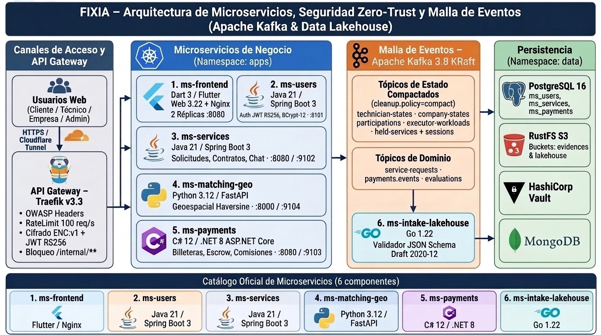
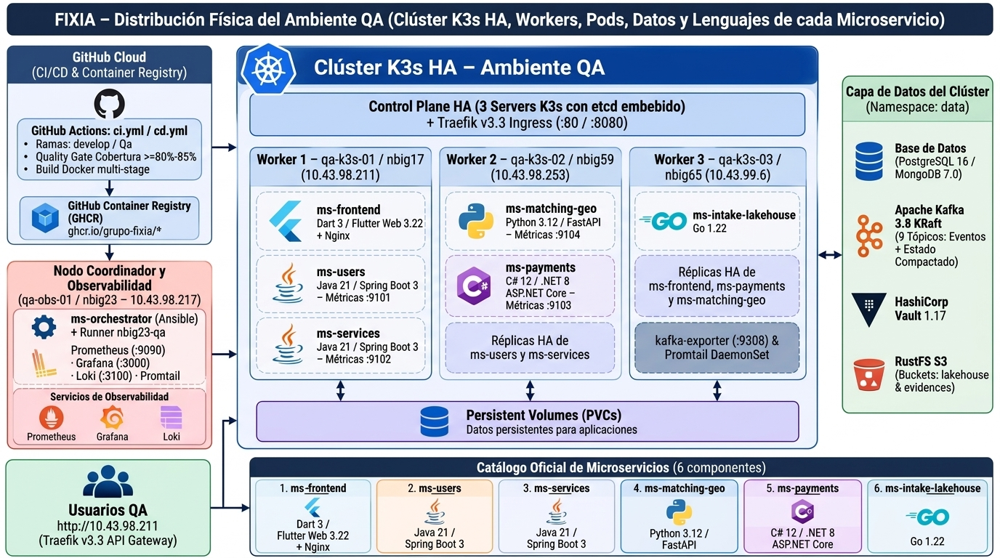
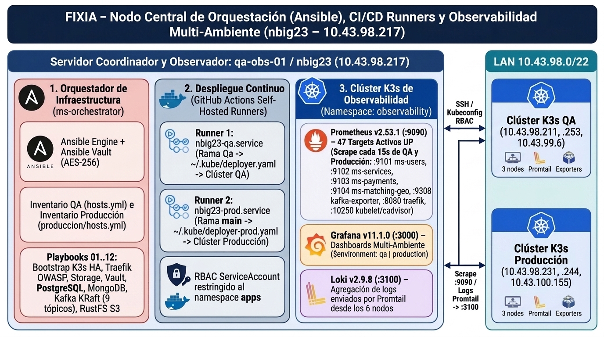
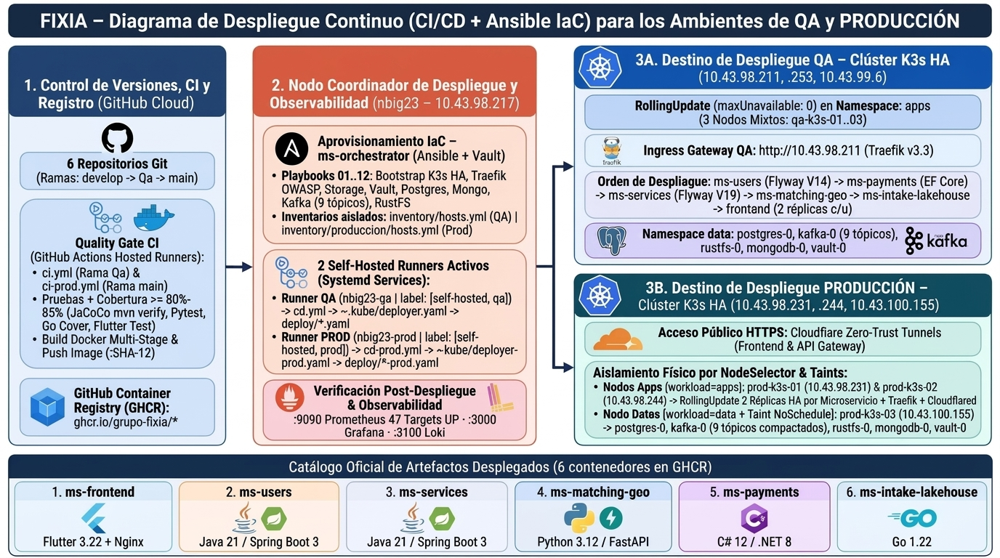

# Índice Maestro de Documentación de Arquitectura e Infraestructura — Plataforma Fixia

Bienvenido al centro de documentación oficial de **Infraestructura, Arquitectura de Alto Nivel (HLD), Seguridad, Malla de Eventos (Kafka) y Operación Continua (IaC + CI/CD)** de la plataforma **Fixia**.

---

## 1. Estructura de Documentos en `docs/`

| Documento | Propósito y Alcance |
| :--- | :--- |
| **[1. Diseño de Alto Nivel (HLD) — Arquitectura e Infraestructura](./HLD-Arquitectura-e-Infraestructura.md)** | Catálogo oficial de los 6 microservicios políglotas, topología de red de los 7 servidores (`10.43.98.0/22`), aislamiento físico `workload=apps` vs. `workload=data` en Producción, malla de eventos Apache Kafka (9 tópicos con replicación de estado compactada `GC-547`) y diagramas visuales. |
| **[2. Estado Operativo e Inventario en Vivo (Producción, QA y Observabilidad)](./Estado-Infraestructura-Arquitectura-V4.md)** | Inventario detallado en tiempo real de nodos K3s (`v1.37.1+k3s1`), pods, imágenes GHCR, Services, PVCs, migraciones Flyway (`V14` y `V19`), los **47/47 targets `UP` de Prometheus** y endurecimiento de seguridad OWASP ZAP + cifrado `ENC:v1`. |
| **[3. Runbook Operativo: Ansible IaC, CI/CD, Kafka, Seguridad y Cloudflare](./Runbook-Operacion-IaC-y-CICD.md)** | Manual paso a paso para ejecutar los playbooks de Ansible (`01` a `12`) en QA y Producción, operar los 2 Self-Hosted Runners (`nbig23-qa` y `nbig23-prod`), administrar los túneles HTTPS de Cloudflare, inspeccionar Kafka/PostgreSQL y verificar los Quality Gates de cobertura. |
| **[4. Visor HTML Interactivo de Diagramas HLD](./hld-arquitectura-interactivo.html)** | Documento HTML autocontenido con renderizado dinámico Mermaid de la arquitectura lógica y física. |
| **[5. Fuente Editable Draw.io](./hld-arquitectura-infraestructura.drawio)** | Archivo fuente vectorial editable para Draw.io / diagrams.net. |

---

## 2. Accesos Públicos HTTPS (Cloudflare Tunnels) y Accesos Internos (LAN)

| Ambiente | Servicio | URL Pública HTTPS (Cloudflare Zero-Trust) | URL Red Interna LAN (`10.43.98.0/22`) |
| :--- | :--- | :--- | :--- |
| **Producción** | **Frontend Web SPA (`ms-frontend`)** | https://hook-excellence-champion-wallet.trycloudflare.com | `http://10.43.98.231` / `http://10.43.98.244` |
| **Producción** | **API Gateway (`traefik`)** | https://fits-descending-section-constant.trycloudflare.com | `http://10.43.98.231/api/...` |
| **Observabilidad** | **Grafana (Dashboards Multi-Ambiente)** | https://logging-districts-beautiful-loose.trycloudflare.com | `http://10.43.98.217:3000` |
| **Observabilidad** | **Prometheus (Métricas — 47 Targets UP)** | https://europe-cattle-stays-ntsc.trycloudflare.com | `http://10.43.98.217:9090` |
| **Observabilidad** | **Grafana Loki (Agregación de Logs)** | — *(Solo ingesta interna por Promtail)* | `http://10.43.98.217:3100` |
| **QA** | **Frontend & API Gateway QA (`traefik`)** | — *(Acceso institucional LAN)* | `http://10.43.98.211` / `.253` / `10.43.99.6` |

---

## 3. Galería Visual de Diagramas de Alto Nivel (`docs/images/`)

### 3.1 Arquitectura de Microservicios, Seguridad Zero-Trust y Malla de Eventos (Kafka + Lakehouse)

### 3.2 Topología General Multi-Ambiente (Red LAN `10.43.98.0/22` y Nodo Central Orquestador/Observador)

### 3.3 Distribución Física del Ambiente de PRODUCCIÓN (Clúster K3s HA, Aislamiento de Datos y Cloudflare Tunnels)

### 3.4 Distribución Física del Ambiente de QA (Clúster K3s HA, Workers, Pods y Datos)

### 3.5 Nodo Central de Orquestación (Ansible), CI/CD Runners y Observabilidad Multi-Ambiente (`10.43.98.217`)

### 3.6 Diagrama de Despliegue Continuo (CI/CD + Ansible IaC) para QA y PRODUCCIÓN

