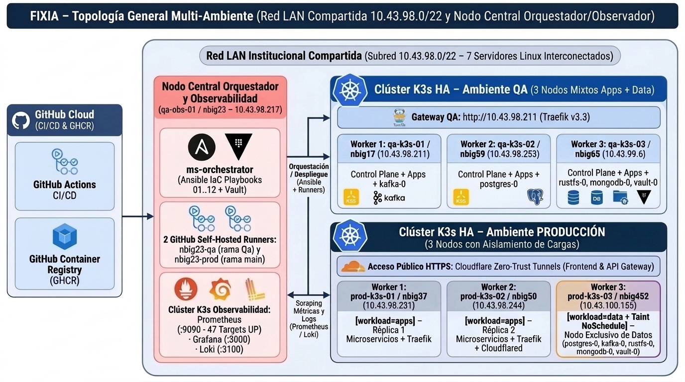
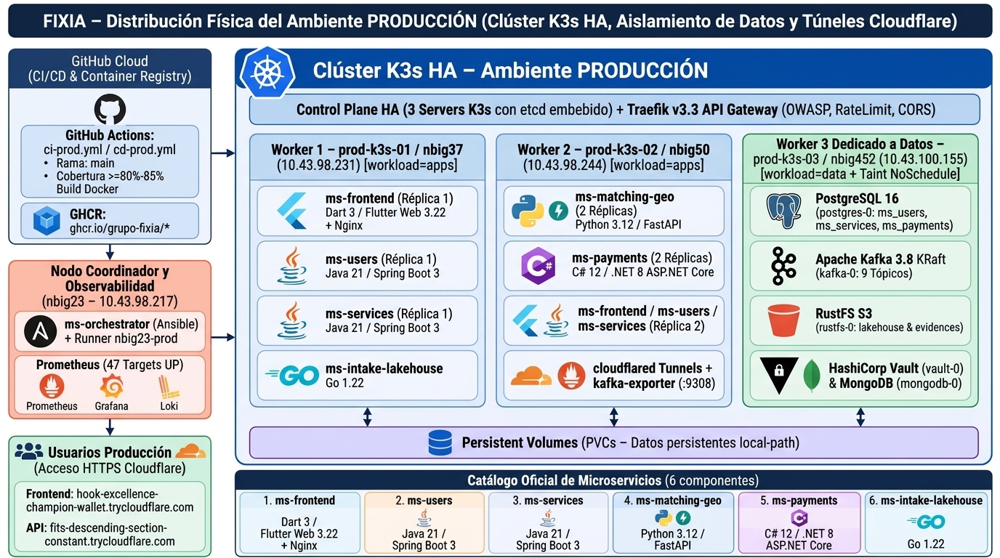
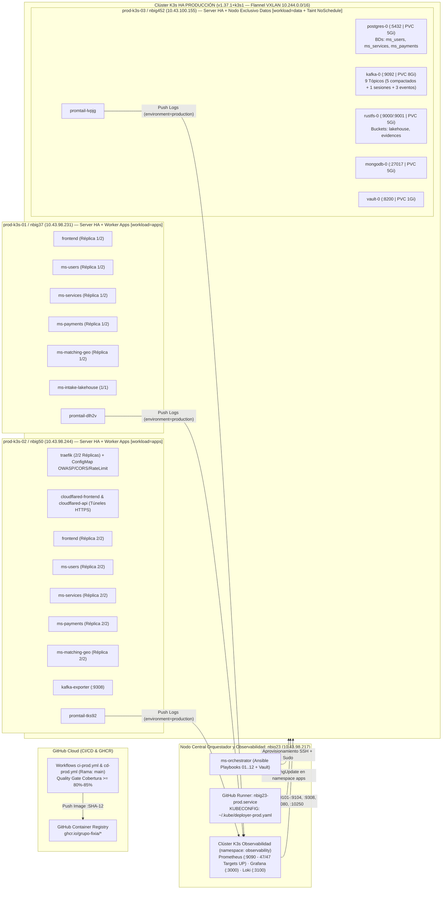
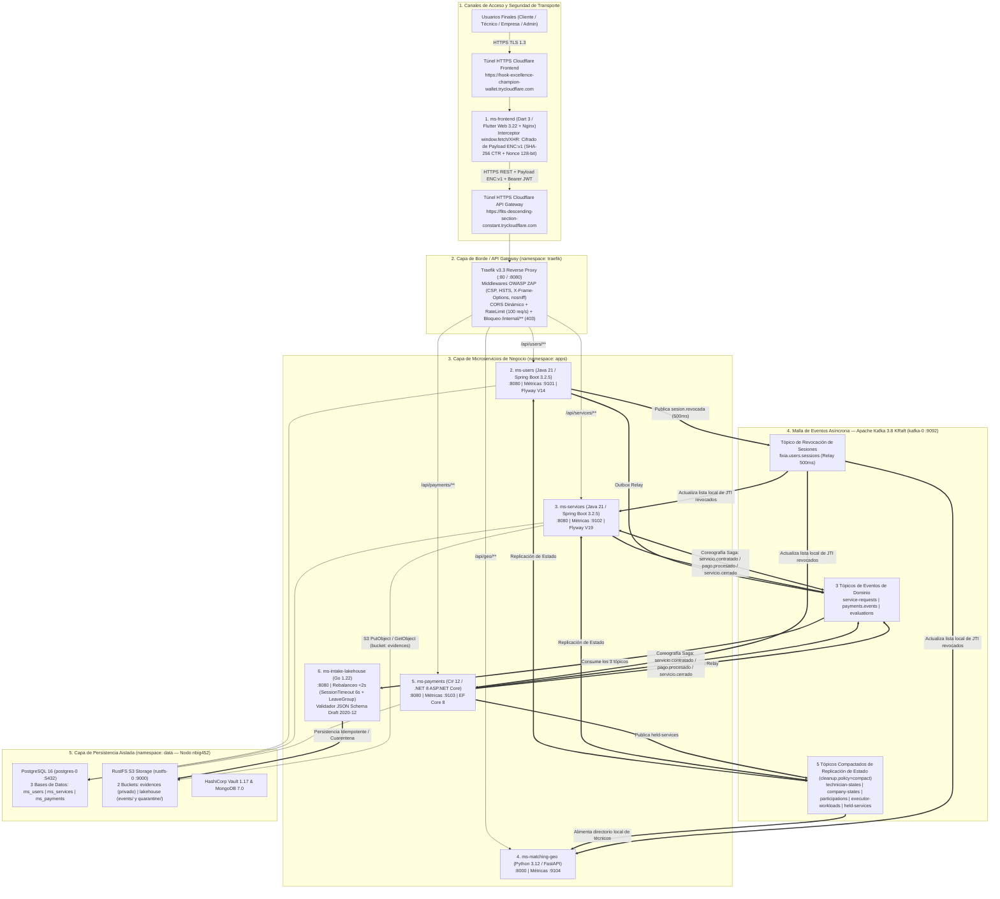

# Documento Maestro de Arquitectura, Infraestructura, Seguridad y Operación — Plataforma Fixia

> **Versión:** 4.0 (Producción, QA, Observabilidad Central y Desarrollo Local)  
> **Fecha de Verificación en Vivo:** 2026-11-24  
> **Estado General:** **100% Operativo** — Clústeres Kubernetes K3s HA activos en **Producción** y **QA**, aislamiento físico de cargas (`workload=apps` vs. `workload=data`), arquitectura orientada a eventos con **cero llamadas HTTP síncronas entre microservicios (`GC-547`)**, 9 tópicos en Apache Kafka KRaft (5 con `cleanup.policy=compact`), migraciones Flyway `V14` y `V19` aplicadas, seguridad OWASP ZAP + cifrado de credenciales `ENC:v1`, **47/47 targets `UP` en Prometheus**, y **4 túneles HTTPS públicos en Cloudflare**.

---

## Tabla de Contenido

1. [Resumen Ejecutivo y Principios Arquitectónicos](#1-resumen-ejecutivo-y-principios-arquitectónicos)
2. [Endpoints Públicos HTTPS (Cloudflare) e Internos (LAN)](#2-endpoints-públicos-https-cloudflare-e-internos-lan)
3. [Catálogo Oficial de Microservicios (Arquitectura Políglota — 6 Componentes)](#3-catálogo-oficial-de-microservicios-arquitectura-políglota--6-componentes)
4. [Topología General Multi-Ambiente (Red LAN `10.43.98.0/22` — 7 Servidores)](#4-topología-general-multi-ambiente-red-lan-104398022--7-servidores)
5. [Arquitectura del Clúster K3s HA de PRODUCCIÓN (Aislamiento Apps vs. Data)](#5-arquitectura-del-clúster-k3s-ha-de-producción-aislamiento-apps-vs-data)
6. [Arquitectura del Clúster K3s HA de QA](#6-arquitectura-del-clúster-k3s-ha-de-qa)
7. [Malla de Eventos Apache Kafka (9 Tópicos), Replicación de Estado y Data Lakehouse](#7-malla-de-eventos-apache-kafka-9-tópicos-replicación-de-estado-y-data-lakehouse)
8. [Seguridad Zero-Trust: Cifrado de Payload `ENC:v1`, JWT RS256, BCrypt-12 y OWASP ZAP](#8-seguridad-zero-trust-cifrado-de-payload-encv1-jwt-rs256-bcrypt-12-y-owasp-zap)
9. [Nodo Central de Orquestación (Ansible IaC), CI/CD Runners y Observabilidad (`47/47 Targets UP`)](#9-nodo-central-de-orquestación-ansible-iac-cicd-runners-y-observabilidad-4747-targets-up)
10. [Runbook Operativo: Comandos Ansible, CI/CD, Cloudflare, Kafka y PostgreSQL](#10-runbook-operativo-comandos-ansible-cicd-cloudflare-kafka-y-postgresql)
11. [Galería Completa de Diagramas de Alto Nivel (HLD)](#11-galería-completa-de-diagramas-de-alto-nivel-hld)

---

## 1. Resumen Ejecutivo y Principios Arquitectónicos

La plataforma **Fixia** está construida sobre una arquitectura de microservicios **Cloud-Native, Políglota y Orientada a Eventos (Event-Driven)** desplegada sobre clústeres **Kubernetes K3s en Alta Disponibilidad (HA)**:

* **Orquestación de Contenedores (Kubernetes K3s HA):** Cada ambiente (**Producción** y **QA**) opera sobre un clúster K3s de 3 servidores con plano de control en Alta Disponibilidad (`etcd` embebido), red superpuesta **Flannel VXLAN** (`10.244.0.0/16` para Pods y `10.245.0.0/16` para Services) y aprovisionamiento de almacenamiento persistente local (`local-path`).
* **Aislamiento Físico de Cargas en Producción:** En el clúster de Producción, los nodos `nbig37` (`10.43.98.231`) y `nbig50` (`10.43.98.244`) están etiquetados con `workload=apps` para ejecutar únicamente los microservicios y el API Gateway, mientras que el nodo `nbig452` (`10.43.100.155`) posee la etiqueta `workload=data` y el taint `workload=data:NoSchedule`, reservando sus recursos de CPU, RAM y disco exclusivamente para **PostgreSQL 16, Apache Kafka 3.8 KRaft, RustFS S3, MongoDB 7.0 y HashiCorp Vault 1.17**.
* **Cero Dependencias HTTP Síncronas entre Microservicios (`GC-547`):** Ningún microservicio realiza llamadas HTTP síncronas a otro microservicio durante el procesamiento de peticiones. El estado compartido se replica asíncronamente a través de **5 tópicos compactados en Apache Kafka (`cleanup.policy=compact`)**, y la revocación de sesiones se propaga en `< 500 ms` mediante el tópico `fixia.users.sessions`.
* **Gobierno Centralizado (`nbig23` — `10.43.98.217`):** Un séptimo servidor en la misma subred institucional (`10.43.98.0/22`) aloja el motor de **Infraestructura como Código (Ansible + Vault)**, los **2 Self-Hosted Runners de GitHub Actions** (`nbig23-qa` y `nbig23-prod`) y el **Clúster K3s de Observabilidad Central** (**Prometheus, Grafana y Loki**) que monitorea los **47 targets** de QA y Producción.

---

## 2. Endpoints Públicos HTTPS (Cloudflare) e Internos (LAN)

| Ambiente | Servicio / Punto de Entrada | URL Pública HTTPS (Cloudflare Zero-Trust Tunnel) | URL Red Interna LAN (`10.43.98.0/22`) | Estado |
| :--- | :--- | :--- | :--- | :---: |
| **Producción** | **Frontend Web SPA (`ms-frontend`)** | https://hook-excellence-champion-wallet.trycloudflare.com | `http://10.43.98.231` / `http://10.43.98.244` | `200 OK` |
| **Producción** | **API Gateway (`traefik`)** | https://fits-descending-section-constant.trycloudflare.com | `http://10.43.98.231/api/...` | `200 OK` |
| **Observabilidad** | **Grafana (Dashboards Multi-Ambiente)** | https://logging-districts-beautiful-loose.trycloudflare.com | `http://10.43.98.217:3000` | `200 OK` |
| **Observabilidad** | **Prometheus (Sistema de Métricas)** | https://europe-cattle-stays-ntsc.trycloudflare.com | `http://10.43.98.217:9090` | `200 OK` (`47/47 UP`) |
| **Observabilidad** | **Grafana Loki (Ingesta de Logs)** | — *(Tráfico interno desde DaemonSets Promtail)* | `http://10.43.98.217:3100` | `Ready` |
| **QA** | **Frontend & API Gateway QA (`traefik`)** | — *(Acceso institucional LAN)* | `http://10.43.98.211` / `.253` / `10.43.99.6` | `200 OK` |

---

## 3. Catálogo Oficial de Microservicios (Arquitectura Políglota — 6 Componentes)

> [!IMPORTANT]
> **Fixia cuenta exclusivamente con 6 componentes de aplicación** (`1 Frontend SPA + 5 Microservicios de Backend`) desplegados en el namespace `apps`:
> - **`ms-orchestrator`** **NO es un microservicio en ejecución**: es el repositorio de **Infraestructura como Código (Ansible + Vault + Manifiestos Kubernetes + Docker Compose)**.
> - **`traefik`** es el **API Gateway / Ingress Controller** (namespace `traefik`).
> - **`cloudflared-*`** son los conectores Zero-Trust de Cloudflare para exposición HTTPS (`TLS 1.3`).
> - **`kafka-exporter`** (`:9308`) y **`promtail`** son agentes recolectores de métricas y logs.

| # | Componente (`namespace: apps`) | Tipo | Lenguaje / Runtime | Framework, Librerías y Seguridad | Puertos (App / Métricas) | Réplicas (QA / Prod) | Persistencia y Tópicos Kafka |
| :-: | :--- | :--- | :--- | :--- | :---: | :---: | :--- |
| **1** | **`ms-frontend`** (`deployment/frontend`) | Frontend Web SPA | **Dart 3.4** | **Flutter Web 3.22** + **Nginx 1.27 Alpine** (Cabeceras OWASP ZAP + Interceptor `window.fetch` y `XMLHttpRequest` con cifrado `ENC:v1`) | `:8080` (Service `:80`) | `2 / 2` | Stateless (Consume el API Gateway por HTTPS en Producción y HTTP en QA). |
| **2** | **`ms-users`** (`deployment/ms-users`) | Microservicio Backend | **Java 21 LTS (OpenJDK 21)** | **Spring Boot 3.2.5**, Spring Security OAuth2 JWT (RS256), BCrypt costo 12, `CredentialCipher` (`ENC:v1`), JPA, Flyway (`V14`), Micrometer | `:8080` / `:9101` (`/actuator/prometheus`) | `2 / 2` | **PostgreSQL 16 (`ms_users`)**.<br/>**Produce:** `fixia.users.evaluations`, `fixia.users.technician-states` (compact), `fixia.users.company-states` (compact), `fixia.users.sessions` (relay `500ms`).<br/>**Consume:** `fixia.services.participations`, `fixia.services.executor-workloads`, `fixia.payments.held-services`. |
| **3** | **`ms-services`** (`deployment/ms-services`) | Microservicio Backend | **Java 21 LTS (OpenJDK 21)** | **Spring Boot 3.2.5**, JPA, Flyway (`V19`), AWS SDK S3 v2 (`evidences`, `max-swallow-size: -1`), Spring Kafka, Micrometer | `:8080` / `:9102` (`/actuator/prometheus`) | `2 / 2` | **PostgreSQL 16 (`ms_services`)** + **RustFS S3 (`evidences`)**.<br/>**Produce:** `fixia.services.service-requests`, `fixia.services.participations` (compact), `fixia.services.executor-workloads` (compact).<br/>**Consume:** `fixia.payments.events`, `fixia.users.technician-states`, `fixia.users.company-states`, `fixia.users.sessions`. |
| **4** | **`ms-matching-geo`** (`deployment/ms-matching-geo`) | Microservicio Backend | **Python 3.12** | **FastAPI 0.111**, Uvicorn, `confluent-kafka 2.6.1`, PyJWT (RS256), Middleware Prometheus nativo | `:8000` / `:9104` (`/actuator/prometheus`, `/metrics`) | `2 / 2` | **In-Memory State Replica (Stateless)**.<br/>**Consume:** `fixia.users.technician-states` (directorio local de técnicos para cálculo Haversine) y `fixia.users.sessions` (lista local de tokens revocados). |
| **5** | **`ms-payments`** (`deployment/ms-payments`) | Microservicio Backend | **C# 12 / .NET 8.0** | **ASP.NET Core 8.0 Web API**, EF Core 8, Npgsql, `Confluent.Kafka`, `PrometheusMetricsMiddleware` | `:8080` / `:9103` (`/actuator/prometheus`, `/metrics`) | `2 / 2` | **PostgreSQL 16 (`ms_payments`)**.<br/>**Produce:** `fixia.payments.events`, `fixia.payments.held-services` (compact).<br/>**Consume:** `fixia.services.service-requests`, `fixia.users.sessions`. |
| **6** | **`ms-intake-lakehouse`** (`deployment/ms-intake-lakehouse`) | Microservicio Worker | **Go (Golang) 1.22** | `segmentio/kafka-go` (`MinBytes: 1`, `SessionTimeout: 6s`, `LeaveGroup` limpio), `minio-go/v7`, `santhosh-tekuri/jsonschema/v5` (Draft 2020-12) | `:8080` (`/health`, `/metrics`) | `1 / 1` | **RustFS S3 (`lakehouse`)**.<br/>**Consume:** `fixia.services.service-requests`, `fixia.payments.events`, `fixia.users.evaluations`. Escribe de forma idempotente en `events/` o envía a `quarantine/`. |

---

## 4. Topología General Multi-Ambiente (Red LAN `10.43.98.0/22` — 7 Servidores)

Todos los **7 servidores Linux (Ubuntu 22.04.5 LTS, Kernel 6.8.0-90-generic amd64)** están interconectados en la misma red institucional y son administrados desde el nodo central **`nbig23` (`10.43.98.217`)**:



| Ambiente | Hostname | Alias Inventario Ansible | Dirección IP | Rol en Kubernetes (K3s) | Etiquetas / Taints de Carga | Cargas Alojadas |
| :--- | :--- | :--- | :---: | :--- | :--- | :--- |
| **Orquestador & Observabilidad** | **`nbig23`** | `qa-obs-01` | `10.43.98.217` | K3s Single-Node (`observability`) + Ansible + GitHub Runners | `control-plane,master` | `prometheus` (`:9090`), `grafana` (`:3000`), `loki-0` (`:3100`), `promtail`, `cloudflared-grafana`, `cloudflared-prometheus`, Runners `nbig23-qa` y `nbig23-prod` |
| **PRODUCCIÓN** | **`nbig37`** | `prod-k3s-01` (`produccion_1`) | `10.43.98.231` | K3s Server HA (`control-plane,etcd`) + App Worker 1 | `workload=apps` | Réplica 1 de `frontend`, `ms-users`, `ms-services`, `ms-payments`, `ms-matching-geo`, `ms-intake-lakehouse`, `promtail` |
| **PRODUCCIÓN** | **`nbig50`** | `prod-k3s-02` (`produccion_2`) | `10.43.98.244` | K3s Server HA (`control-plane,etcd`) + App Worker 2 | `workload=apps` | Réplica 2 de `frontend`, `ms-users`, `ms-services`, `ms-payments`, `ms-matching-geo`, `traefik` (x2), `cloudflared-frontend`, `cloudflared-api`, `kafka-exporter`, `promtail` |
| **PRODUCCIÓN** | **`nbig452`** | `prod-k3s-03` (`produccion_3`) | `10.43.100.155` | K3s Server HA (`control-plane,etcd`) + **Data Node Exclusivo** | `workload=data` + **Taint `workload=data:NoSchedule`** | **Exclusivo Capa de Datos (`namespace: data`):** `postgres-0` (5Gi), `kafka-0` (8Gi), `rustfs-0` (5Gi), `mongodb-0` (5Gi), `vault-0` (1Gi), `promtail` |
| **QA** | **`nbig17`** | `qa-k3s-01` | `10.43.98.211` | K3s Server HA (`control-plane,etcd`) + Worker Mixto 1 | Mixto (`apps` + `data`) | `kafka-0`, `traefik`, pods de `apps`, `promtail` |
| **QA** | **`nbig59`** | `qa-k3s-02` | `10.43.98.253` | K3s Server HA (`control-plane,etcd`) + Worker Mixto 2 | Mixto (`apps` + `data`) | `postgres-0`, `kafka-exporter`, pods de `apps`, `promtail` |
| **QA** | **`nbig65`** | `qa-k3s-03` | `10.43.99.6` | K3s Server HA (`control-plane,etcd`) + Worker Mixto 3 | Mixto (`apps` + `data`) | `rustfs-0`, `mongodb-0`, `vault-0`, `traefik`, pods de `apps`, `promtail` |

---

## 5. Arquitectura del Clúster K3s HA de PRODUCCIÓN (Aislamiento Apps vs. Data)



### 5.1 Nodos del Clúster de Producción (`v1.37.1+k3s1`)
```text
NAME      STATUS   ROLES                VERSION        INTERNAL-IP     OS-IMAGE             CONTAINER-RUNTIME         WORKLOAD LABEL & TAINT
nbig37    Ready    control-plane,etcd   v1.37.1+k3s1   10.43.98.231    Ubuntu 22.04.5 LTS   containerd://2.3.4-k3s1   workload=apps
nbig50    Ready    control-plane,etcd   v1.37.1+k3s1   10.43.98.244    Ubuntu 22.04.5 LTS   containerd://2.3.4-k3s1   workload=apps
nbig452   Ready    control-plane,etcd   v1.37.1+k3s1   10.43.100.155   Ubuntu 22.04.5 LTS   containerd://2.3.4-k3s1   workload=data (Taint: workload=data:NoSchedule)
```

### 5.2 Microservicios Desplegados en Producción (`namespace: apps` — Rama `main`)
| Deployment | Imagen Oficial en GHCR | Réplicas Listas | Pod en `nbig37` (`10.43.98.231`) | Pod en `nbig50` (`10.43.98.244`) |
| :--- | :--- | :---: | :--- | :--- |
| **`frontend`** | `ghcr.io/grupo-fixia/ms-frontend:bafc723f4d51` | **2/2** | `frontend-694c84d9f6-2w7w6` (`10.244.0.38`) | `frontend-694c84d9f6-mldng` (`10.244.1.43`) |
| **`ms-users`** | `ghcr.io/grupo-fixia/ms-users:236f5a7d0119` | **2/2** | `ms-users-79bf96ccc-tvkq2` (`10.244.0.35`) | `ms-users-79bf96ccc-vwvbs` (`10.244.1.41`) |
| **`ms-services`** | `ghcr.io/grupo-fixia/ms-services:197642a78537` | **2/2** | `ms-services-54cffdc77f-x6zkr` (`10.244.0.39`) | `ms-services-54cffdc77f-xbwqm` (`10.244.1.44`) |
| **`ms-payments`** | `ghcr.io/grupo-fixia/ms-payments:cd15779e1de1` | **2/2** | `ms-payments-54db76984f-rv4rg` (`10.244.0.33`) | `ms-payments-54db76984f-v2mm5` (`10.244.1.39`) |
| **`ms-matching-geo`** | `ghcr.io/grupo-fixia/ms-matching-geo:202e0e2ed403` | **2/2** | `ms-matching-geo-845bf76958-qs8hq` (`10.244.0.31`) | `ms-matching-geo-845bf76958-cctmz` (`10.244.1.37`) |
| **`ms-intake-lakehouse`** | `ghcr.io/grupo-fixia/ms-intake-lakehouse:fd6f248ce16e` | **1/1** | `ms-intake-lakehouse-7cf47b6c5d-bv2k8` (`10.244.0.36`) | — |
| **`cloudflared-frontend`** | `cloudflare/cloudflared:latest` | **1/1** | — | `cloudflared-frontend-647bfdc976-psq9c` (`10.244.1.25`) |
| **`kafka-exporter`** | `danielqsj/kafka-exporter:v1.8.0` | **1/1** | — | `kafka-exporter-57976d699d-5fd82` (`10.244.1.6`) |

### 5.3 Servicios de Red (`Service`) e Ingress en Producción (`namespace: apps`)
```text
NAME                              TYPE           CLUSTER-IP       EXTERNAL-IP                 PORT(S)          SELECTOR
service/frontend                  ClusterIP      10.245.96.205    <none>                      80/TCP           app=frontend
service/ms-users                  ClusterIP      10.245.224.138   <none>                      8080/TCP         app=ms-users
service/ms-users-metrics          LoadBalancer   10.245.106.68    10.43.98.231,10.43.98.244   9101:30776/TCP   app=ms-users
service/ms-services               ClusterIP      10.245.177.49    <none>                      8080/TCP         app=ms-services
service/ms-services-metrics       LoadBalancer   10.245.160.231   10.43.98.231,10.43.98.244   9102:30458/TCP   app=ms-services
service/ms-payments               ClusterIP      10.245.138.40    <none>                      8080/TCP         app=ms-payments
service/ms-payments-metrics       LoadBalancer   10.245.193.209   10.43.98.231,10.43.98.244   9103:32063/TCP   app=ms-payments
service/ms-matching-geo           ClusterIP      10.245.124.137   <none>                      8000/TCP         app=ms-matching-geo
service/ms-matching-geo-metrics   LoadBalancer   10.245.16.249    10.43.98.231,10.43.98.244   9104:30450/TCP   app=ms-matching-geo
service/ms-intake-lakehouse       ClusterIP      10.245.211.228   <none>                      8080/TCP         app=ms-intake-lakehouse
service/kafka-exporter            LoadBalancer   10.245.39.22     10.43.98.231,10.43.98.244   9308:31924/TCP   app=kafka-exporter
```

### 5.4 Capa de Datos Aislada en Producción (`namespace: data` en `nbig452` — `10.43.100.155`)
Todos los `StatefulSets` de la capa de datos incluyen `nodeSelector: { workload: data }` y `tolerations: [{ key: "workload", operator: "Equal", value: "data", effect: "NoSchedule" }]`:

```text
NAME                    READY   STATUS      RESTARTS   IP            NODE      PVC ASOCIADO          CAPACIDAD   STORAGECLASS
pod/postgres-0          1/1     Running     0          10.244.2.7    nbig452   data-postgres-0       5Gi         local-path
pod/kafka-0             1/1     Running     0          10.244.2.11   nbig452   data-kafka-0          8Gi         local-path
pod/rustfs-0            1/1     Running     0          10.244.2.14   nbig452   data-rustfs-0         5Gi         local-path
pod/mongodb-0           1/1     Running     0          10.244.2.9    nbig452   data-mongodb-0        5Gi         local-path
pod/vault-0             1/1     Running     0          10.244.2.5    nbig452   data-vault-0          1Gi         local-path
pod/rustfs-init-k2ckf   0/1     Completed   0          10.244.2.12   nbig452   (Job inicializador)   —           —
```

### 5.5 Diagrama Mermaid de Distribución Física en Producción


---

## 6. Arquitectura del Clúster K3s HA de QA


### Deployments e Imágenes Activas en QA (`namespace: apps` — Rama `Qa`)
| Deployment | Imagen Oficial en GHCR | Réplicas Listas | Nodos Alojados |
| :--- | :--- | :---: | :--- |
| **`frontend`** | `ghcr.io/grupo-fixia/ms-frontend:bafc723f4d51` | **2/2** | `nbig59` (`10.244.1.83`), `nbig65` (`10.244.3.81`) |
| **`ms-users`** | `ghcr.io/grupo-fixia/ms-users:556ccf63981f` | **2/2** | `nbig59` (`10.244.1.82`), `nbig65` (`10.244.3.80`) |
| **`ms-services`** | `ghcr.io/grupo-fixia/ms-services:ac127d97f8a3` | **2/2** | `nbig17` (`10.244.0.86`), `nbig65` (`10.244.3.82`) |
| **`ms-payments`** | `ghcr.io/grupo-fixia/ms-payments:fc71baaf2bf3` | **2/2** | `nbig17` (`10.244.0.83`), `nbig59` (`10.244.1.80`) |
| **`ms-matching-geo`** | `ghcr.io/grupo-fixia/ms-matching-geo:552755ebfcd0` | **2/2** | `nbig17` (`10.244.0.80`, `10.244.0.81`) |
| **`ms-intake-lakehouse`** | `ghcr.io/grupo-fixia/ms-intake-lakehouse:b4e660fec8da` | **1/1** | `nbig17` (`10.244.0.85`) |
| **`kafka-exporter`** | `danielqsj/kafka-exporter:v1.8.0` | **1/1** | `nbig59` (`10.244.1.16`) |

---

## 7. Malla de Eventos Apache Kafka (9 Tópicos), Replicación de Estado y Data Lakehouse


### 7.1 Tabla Completa de los 9 Tópicos en Apache Kafka 3.8 KRaft (`kafka-0`)
| # | Nombre del Tópico | Particiones | `cleanup.policy` | Productor | Consumidores | Propósito en la Arquitectura |
| :-: | :--- | :---: | :---: | :--- | :--- | :--- |
| **1** | `fixia.users.technician-states` | `1` | **`compact`** | `ms-users` | `ms-services`, `ms-matching-geo` | Réplica local del perfil, categorías, zona, horario, reputación y empresa asociada de cada técnico (`GC-547`). |
| **2** | `fixia.users.company-states` | `1` | **`compact`** | `ms-users` | `ms-services` | Réplica local del estado activo, nombre comercial y reputación de cada empresa (`GC-547`). |
| **3** | `fixia.services.participations` | `1` | **`compact`** | `ms-services` | `ms-users` | Réplica de contratos cerrados (`clientId`, `providerId`, `executorId`, `providerType`) para validar evaluaciones sin llamar a `ms-services`. |
| **4** | `fixia.services.executor-workloads` | `1` | **`compact`** | `ms-services` | `ms-users` | Réplica de trabajos activos asignados a técnicos de empresa para validar desvinculaciones sin llamadas HTTP. |
| **5** | `fixia.payments.held-services` | `1` | **`compact`** | `ms-payments` | `ms-users` | Réplica de servicios con saldo retenido (escrow) por prestador (`GC-547`). |
| **6** | `fixia.users.sessions` | `1` | `delete` (`24h`) | `ms-users` (`500ms`) | `ms-services`, `ms-payments`, `ms-matching-geo` | Propagación inmediata de `sesion.revocada` (`jti` y `expiresAt`) al hacer logout para revocación local sin consultar a `ms-users`. |
| **7** | `fixia.services.service-requests` | `3` | `delete` (`1GB`) | `ms-services` | `ms-payments`, `ms-intake-lakehouse` | Eventos de negocio del ciclo de vida del servicio (`solicitud.publicada`, `solicitud.cancelada`, `postulacion.registrada`, `prestador.seleccionado`, `cotizacion.enviada`, `cotizacion.rechazada`, `servicio.contratado`, `servicio.iniciado`, `evidencia.registrada`, `servicio.finalizado`, `servicio.cierre_objetado`, `servicio.cerrado`). |
| **8** | `fixia.payments.events` | `3` | `delete` (`1GB`) | `ms-payments` | `ms-services`, `ms-intake-lakehouse` | Eventos de negocio de pagos (`pago.creado`, `pago.procesado`, `pago.fallido`, `pago.completado`, `pago.reembolsado`). |
| **9** | `fixia.users.evaluations` | `3` | `delete` (`1GB`) | `ms-users` | `ms-intake-lakehouse` | Eventos de negocio de usuarios (`evaluacion.registrada`, `empresa.tecnico_vinculado`, `empresa.tecnico_desvinculado`). |

### 7.2 Diagrama Mermaid de Arquitectura Lógica y Coreografía por Kafka


### 7.3 Migraciones de Base de Datos Verificadas en Producción y QA (`postgres-0`)
* **`ms_users` (Flyway):** Versión **`V14__state_replication` (`success = t`)**.
* **`ms_services` (Flyway):** Versión **`V19__state_replication` (`success = t`)**.
* **`ms_payments` (EF Core 8):** Migraciones aplicadas automáticamente al arranque (`DatabaseMigrator.ApplyMigrationsAsync`).

---

## 8. Seguridad Zero-Trust: Cifrado de Payload `ENC:v1`, JWT RS256, BCrypt-12 y OWASP ZAP

1. **Cifrado de Credenciales en Payload (`ENC:v1:<nonce_hex>:<ciphertext_b64>`):**
   * En el frontend (`ms-frontend/web/index.html`), un interceptor sobre `window.fetch` (compatible con cuerpos binarios `Uint8Array` de Flutter `package:http` v1.6.0 y strings) y `XMLHttpRequest.prototype.send` detecta cualquier petición JSON con el campo `"password"`, genera un nonce criptográfico aleatorio de 128 bits (`window.crypto.getRandomValues`) y cifra la contraseña mediante un flujo **SHA-256 CTR** antes de que aparezca en el inspector de red (F12) del navegador.
   * En el backend (`ms-users`), la clase `CredentialCipher.java` invocada en los constructores compactos de `LoginRequest`, `ClientRegistrationRequest` y `TechnicianRegistrationRequest` descifra `ENC:v1:` en memoria antes de pasar la contraseña al validador **BCrypt con costo 12** (`BCryptPasswordEncoder(12)`).
2. **Autenticación JWT Asimétrica (`RS256`) y Revocación Distribuida:**
   * `ms-users` firma los tokens con su clave privada RSA (`PKCS#8`) incluyendo `sub` (`usr_<uuid>`), `roles` (`ROLE_CLIENT`, `ROLE_PROFESSIONAL`, `ROLE_COMPANY`, `ROLE_ADMIN`), `jti`, `iss` y `aud`.
   * `ms-services`, `ms-payments` y `ms-matching-geo` validan localmente la firma con la clave pública RSA (`X.509`) y verifican que el `jti` no esté en su réplica local alimentada por el tópico `fixia.users.sessions`. Si la réplica supera el tiempo máximo de desactualización (`max-staleness`), el servicio **falla cerrado (`401 Unauthorized`)**.
3. **Endurecimiento OWASP ZAP en Traefik y Nginx:**
   * Cabeceras inyectadas en todas las respuestas: `Content-Security-Policy`, `Strict-Transport-Security: max-age=31536000; includeSubDomains`, `X-Content-Type-Options: nosniff`, `X-Frame-Options: DENY`, `Referrer-Policy: strict-origin-when-cross-origin`, `Permissions-Policy: camera=(), microphone=(), geolocation=(), payment=()`, `Cache-Control: no-store, no-cache, must-revalidate` en rutas de API y `server_tokens off`.
   * Bloqueo perimetral de `/internal/**` en Traefik con prioridad `1000`.

---

## 9. Nodo Central de Orquestación (Ansible IaC), CI/CD Runners y Observabilidad (`47/47 Targets UP`)


### 9.1 Los 47 Targets Activos (`UP`) en Prometheus (`10.43.98.217:9090`)
Todos los microservicios exponen métricas HTTP (`http_server_requests_seconds_count`, `http_server_requests_seconds_sum`) con plantillas de ruta normalizadas (sin `uri="UNKNOWN"`):

| Ambiente | Job de Prometheus | Puerto / Ruta de Scrape | Targets (`UP`) |
| :--- | :--- | :--- | :---: |
| **Observabilidad (`10.43.98.217`)** | `prometheus`, `loki`, `obs-k3s-node`, `obs-k3s-pods` | `:9090/metrics`, `:3100/metrics`, `:443/.../cadvisor` | **5 / 5 UP** |
| **Producción (`10.43.98.231`, `.244`, `10.43.100.155`)** | `prod-k3s-nodes-cadvisor` & `prod-k3s-nodes-kubelet` | `:10250/metrics/cadvisor` & `:10250/metrics` (3 nodos) | **6 / 6 UP** |
| **Producción (`10.43.98.231`, `.244`)** | `prod-traefik` & `prod-kafka` | `:8080/metrics` & `:9308/metrics` (2 nodos apps) | **4 / 4 UP** |
| **Producción (`10.43.98.231`, `.244`)** | `prod-ms-users` (`:9101`), `prod-ms-services` (`:9102`), `prod-ms-payments` (`:9103`), `prod-ms-matching-geo` (`:9104`) | `/actuator/prometheus` (4 servicios × 2 nodos apps) | **8 / 8 UP** |
| **QA (`10.43.98.211`, `.253`, `10.43.99.6`)** | `qa-k3s-nodes-cadvisor` & `qa-k3s-nodes-kubelet` | `:10250/metrics/cadvisor` & `:10250/metrics` (3 nodos) | **6 / 6 UP** |
| **QA (`10.43.98.211`, `.253`, `10.43.99.6`)** | `qa-traefik` & `qa-kafka` | `:8080/metrics` & `:9308/metrics` (3 nodos) | **6 / 6 UP** |
| **QA (`10.43.98.211`, `.253`, `10.43.99.6`)** | `qa-ms-users` (`:9101`), `qa-ms-services` (`:9102`), `qa-ms-payments` (`:9103`), `qa-ms-matching-geo` (`:9104`) | `/actuator/prometheus` (4 servicios × 3 nodos) | **12 / 12 UP** |
| **TOTAL GLOBAL** | **21 Jobs Multi-Ambiente** | — | **47 / 47 UP (100%)** |

### 9.2 Pipelines CI/CD y Quality Gates por Repositorio


| Repositorio | Comando de Prueba y Quality Gate en CI (`ci.yml` y `ci-prod.yml`) | Umbral de Cobertura | Workflows de Despliegue (`cd.yml` / `cd-prod.yml`) |
| :--- | :--- | :---: | :--- |
| **`ms-users`** | `mvn -B verify` (`jacoco-maven-plugin` en fase `verify`) | **`>= 80%`** | `deploy/ms-users.yaml` (QA) \| `deploy/ms-users-prod.yaml` (Prod) |
| **`ms-services`** | `mvn -B verify` (`jacoco-maven-plugin` en fase `verify`) | **`>= 85%`** | `deploy/ms-services.yaml` (QA) \| `deploy/ms-services-prod.yaml` (Prod) |
| **`ms-matching-geo`** | `python -m pytest --cov=src/app --cov-fail-under=85` | **`>= 85%`** | `deploy/ms-matching-geo.yaml` (QA) \| `deploy/ms-matching-geo-prod.yaml` (Prod) |
| **`ms-intake-lakehouse`** | `go test -v -coverprofile=coverage.out ./internal/...` + validación AWK | **`>= 80%`** | `deploy/ms-intake-lakehouse.yaml` (QA) \| `deploy/ms-intake-lakehouse-prod.yaml` (Prod) |
| **`ms-frontend`** | `flutter analyze` + `flutter test --coverage` + `check_coverage.sh` | **`>= 80%`** | `deploy/frontend.yaml` (QA) \| `deploy/frontend-prod.yaml` (Prod) |
| **`ms-payments`** | `dotnet test Fixia.Payments.sln -c Release` (xUnit + PostgreSQL 16 real) | Suite de integración completa | `deploy/ms-payments.yaml` (QA) \| `deploy/ms-payments-prod.yaml` (Prod) |

---

## 10. Runbook Operativo: Comandos Ansible, CI/CD, Cloudflare, Kafka y PostgreSQL

### 10.1 Ejecución de Playbooks Ansible (`ms-orchestrator/ansible/`)
```bash
cd /home/estudiante/arqui/ms-orchestrator/ansible

# Aprovisionamiento completo sobre Producción (inventory/produccion/hosts.yml)
ansible-playbook -i inventory/produccion/hosts.yml playbooks/01-prepare.yml
ansible-playbook -i inventory/produccion/hosts.yml playbooks/02-k3s-bootstrap.yml
ansible-playbook -i inventory/produccion/hosts.yml playbooks/04-observability.yml
ansible-playbook -i inventory/produccion/hosts.yml playbooks/05-traefik.yml
ansible-playbook -i inventory/produccion/hosts.yml playbooks/05b-cloudflared-api.yml
ansible-playbook -i inventory/produccion/hosts.yml playbooks/06-storage.yml
ansible-playbook -i inventory/produccion/hosts.yml playbooks/07-vault.yml
ansible-playbook -i inventory/produccion/hosts.yml playbooks/08-postgresql.yml
ansible-playbook -i inventory/produccion/hosts.yml playbooks/09-mongodb.yml
ansible-playbook -i inventory/produccion/hosts.yml playbooks/10-kafka.yml
ansible-playbook -i inventory/produccion/hosts.yml playbooks/10b-rustfs.yml
ansible-playbook -i inventory/produccion/hosts.yml playbooks/11-apps.yml
ansible-playbook -i inventory/produccion/hosts.yml playbooks/12-apps-bootstrap.yml
```

### 10.2 Verificación de Pods, Runners y Túneles Cloudflare desde `10.43.98.217`
```bash
# 1. Estado de los Runners de GitHub Actions (QA y Producción)
systemctl status actions.runner.Grupo-Fixia.nbig23-qa.service
systemctl status actions.runner.Grupo-Fixia.nbig23-prod.service

# 2. Estado de microservicios en QA y Producción
kubectl --kubeconfig=/home/estudiante/.kube/deployer.yaml get deployments,pods,svc -n apps -o wide
kubectl --kubeconfig=/home/estudiante/.kube/deployer-prod.yaml get deployments,pods,svc -n apps -o wide

# 3. Consultar URLs activas de los 4 Túneles Cloudflare
ssh estudiante@10.43.98.231 "sudo k3s kubectl logs -n apps deployment/cloudflared-frontend | grep -o 'https://[a-z0-9-]*\.trycloudflare\.com' | tail -n 1"
ssh estudiante@10.43.98.231 "sudo k3s kubectl logs -n traefik deployment/cloudflared-api | grep -o 'https://[a-z0-9-]*\.trycloudflare\.com' | tail -n 1"
k3s kubectl logs -n observability deployment/cloudflared-grafana | grep -o 'https://[a-z0-9-]*\.trycloudflare\.com' | tail -n 1
k3s kubectl logs -n observability deployment/cloudflared-prometheus | grep -o 'https://[a-z0-9-]*\.trycloudflare\.com' | tail -n 1

# 4. Consultar Tópicos de Kafka y Migraciones Flyway en Producción
ssh estudiante@10.43.98.231 "sudo k3s kubectl exec -n data kafka-0 -- /opt/kafka/bin/kafka-topics.sh --bootstrap-server localhost:9092 --describe"
ssh estudiante@10.43.98.231 "sudo k3s kubectl exec -n data postgres-0 -- psql -U postgres -d ms_users -c 'SELECT installed_rank, version, description, success FROM flyway_schema_history ORDER BY installed_rank DESC LIMIT 5;'"
ssh estudiante@10.43.98.231 "sudo k3s kubectl exec -n data postgres-0 -- psql -U postgres -d ms_services -c 'SELECT installed_rank, version, description, success FROM flyway_schema_history ORDER BY installed_rank DESC LIMIT 5;'"
```

---

## 11. Galería Completa de Diagramas de Alto Nivel (HLD)

| # | Diagrama | Archivo en el Repositorio |
| :-: | :--- | :--- |
| **1** | **Arquitectura de Microservicios, Seguridad Zero-Trust y Malla de Eventos (Kafka & Lakehouse)** | [`./images/01-arquitectura-microservicios-kafka-lakehouse.jpg`](./images/01-arquitectura-microservicios-kafka-lakehouse.jpg) |
| **2** | **Topología General Multi-Ambiente (Red LAN `10.43.98.0/22` y Nodo Central Orquestador/Observador)** | [`./images/02-topologia-general-multi-ambiente.jpg`](./images/02-topologia-general-multi-ambiente.jpg) |
| **3** | **Distribución Física del Ambiente de PRODUCCIÓN (Clúster K3s HA, Aislamiento de Datos y Cloudflare)** | [`./images/03-infraestructura-fisica-produccion.jpg`](./images/03-infraestructura-fisica-produccion.jpg) |
| **4** | **Distribución Física del Ambiente de QA (Clúster K3s HA, Workers, Pods y Datos)** | [`./images/04-infraestructura-fisica-qa.jpg`](./images/04-infraestructura-fisica-qa.jpg) |
| **5** | **Nodo Central de Orquestación (Ansible), CI/CD Runners y Observabilidad (`10.43.98.217`)** | [`./images/05-nodo-central-orquestador-observabilidad.jpg`](./images/05-nodo-central-orquestador-observabilidad.jpg) |
| **6** | **Diagrama de Despliegue Continuo (CI/CD + Ansible IaC) para QA y PRODUCCIÓN** | [`./images/06-despliegue-cicd-qa-y-produccion.jpg`](./images/06-despliegue-cicd-qa-y-produccion.jpg) |
| **7** | **Sistema de Calificación de Gestión de Riesgos (Matriz 5x5 y Puntaje en Vivo)** | [`./images/07-sistema-calificacion-riesgos.jpg`](./images/07-sistema-calificacion-riesgos.jpg) — Ver documento completo: **[`Sistema-Calificacion-Riesgos-Fixia.md`](./Sistema-Calificacion-Riesgos-Fixia.md)** |
| **8** | **Plan de Recuperación ante Incidentes y Autocuración (DRP / MTTD / MTTR / RPO / RTO)** | [`./images/08-recuperacion-incidentes-drp.jpg`](./images/08-recuperacion-incidentes-drp.jpg) — Ver documento completo: **[`Plan-Recuperacion-Incidentes-DRP-Fixia.md`](./Plan-Recuperacion-Incidentes-DRP-Fixia.md)** |
