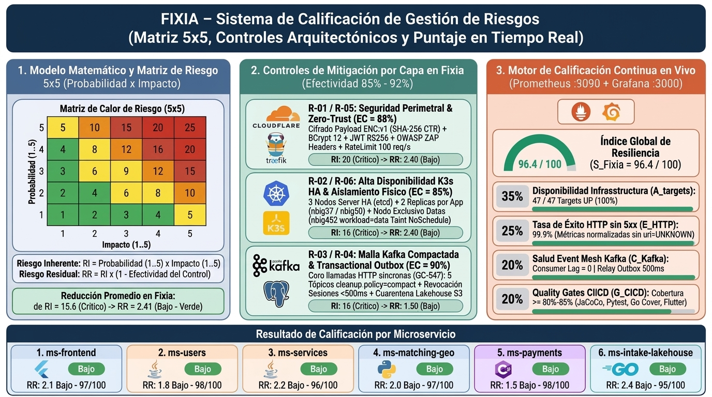

# Sistema de Calificación de Gestión de Riesgos — Plataforma Fixia

> **Documento:** `docs/Sistema-Calificacion-Riesgos-Fixia.md`  
> **Versión:** 4.0 (Aplicado a Producción, QA y Observabilidad Central)  
> **Fecha de Evaluación:** 2026-11-26  
> **Calificación Global de Resiliencia y Control de Riesgos ($S_{\text{Fixia}}$):** **`96.6 / 100` (Nivel A+ — Riesgo Residual Bajo: `2.26 / 25`)**

---

## 1. Diagrama General del Sistema de Calificación de Riesgos en Fixia

---

## 2. Metodología y Modelo Matemático de Calificación

El **Sistema de Calificación de Gestión de Riesgos de Fixia** evalúa de forma continua y cuantitativa las amenazas operativas, de seguridad, de integridad de datos y de disponibilidad sobre los **6 microservicios políglotas** y los **3 clústeres K3s** (Producción, QA y Observabilidad).

### 2.1 Ecuaciones de Riesgo Inherente ($R_I$) y Riesgo Residual ($R_R$)

1. **Riesgo Inherente ($R_I$):** Evalúa la severidad bruta del evento antes de aplicar los controles arquitectónicos de Fixia, en una matriz de $5 \times 5$:
   $$R_I = P \times I \quad \in [1, 25]$$
   * **$P \in \{1, 2, 3, 4, 5\}$ (Probabilidad):** `1` = Remota ($<1\%$ anual), `2` = Improbable, `3` = Posible, `4` = Probable, `5` = Frecuente (ocurre regularmente en sistemas distribuidos, ej. reinicio de contenedores o intentos de intrusión).
   * **$I \in \{1, 2, 3, 4, 5\}$ (Impacto en el Negocio):** `1` = Insignificante, `2` = Menor, `3` = Moderado (degradación parcial), `4` = Mayor (indisponibilidad de un flujo clave), `5` = Catastrófico (pérdida de dinero en billeteras, fuga de credenciales o caída total del sistema).

2. **Efectividad Combinada de Controles ($E_C$):** Mide la reducción porcentual del riesgo aportada por las capas de defensa implementadas en Fixia (Prevención $C_{\text{prev}}$, Detección $C_{\text{det}}$ y Mitigación Automática $C_{\text{mit}}$):
   $$E_C = 1 - \prod_{k=1}^{n} (1 - c_k) \quad \in [0, 0.95]$$

3. **Riesgo Residual ($R_R$):** Es el riesgo neto que permanece tras aplicar los controles verificados en el entorno:
   $$R_R = R_I \times (1 - E_C) \quad \in [1.0, 25.0]$$

### 2.2 Escala Oficial de Calificación de Riesgos

| Nivel de Riesgo | Rango de Puntaje ($R_I$ o $R_R$) | Clasificación Operativa | Acción Requerida en Fixia |
| :---: | :---: | :--- | :--- |
| **🟢 BAJO** | **`1.00 – 4.99`** | **Riesgo Controlado (Aceptable)** | Mitigado automáticamente por *Self-Healing* (K3s HA, Kafka Compactado, Outbox, OWASP). Monitoreo continuo en Prometheus. |
| **🟡 MODERADO** | **`5.00 – 9.99`** | **Riesgo Tolerable con Vigilancia** | Degradación elegante (*Graceful Degradation*). Requiere revisión programada o alerta preventiva en Grafana. |
| **🟠 ALTO** | **`10.00 – 14.99`** | **Riesgo No Deseado** | Requiere ejecución inmediata de Runbook Ansible (`ms-orchestrator`) o rollback CI/CD. |
| **🔴 CRÍTICO** | **`15.00 – 25.00`** | **Riesgo Inaceptable (SPOF)** | Bloquea el paso a Producción (Quality Gate fallido). Exige rediseño arquitectónico inmediato. |

---

## 3. Matriz de Calor ($5 \times 5$): Transición de Riesgo Inherente a Riesgo Residual

```mermaid
flowchart LR
    subgraph Inherente["ANTES DE CONTROLES: Riesgo Inherente Promedio = 15.80 (🔴 CRÍTICO)"]
        RI1["R-01: Caída Nodo App (RI = 15)"]
        RI2["R-02: Caída Microservicio Vecino (RI = 16)"]
        RI3["R-03: Pérdida Evento Pago/Contrato (RI = 15)"]
        RI4["R-04: Uso de Token Revocado (RI = 15)"]
        RI5["R-05: Robo Contraseña en Red F12 (RI = 20)"]
        RI6["R-06: Ataque Web XSS/CORS/DoS (RI = 20)"]
        RI7["R-07: Vecino Ruidoso CPU -> BD/Kafka (RI = 16)"]
        RI8["R-08: Evento Corrupto en Lakehouse (RI = 12)"]
        RI9["R-09: Rebalanceo Lento Kafka 56s (RI = 12)"]
        RI10["R-10: Regresión en Despliegue Prod (RI = 17)"]
    end

    subgraph Motor["CAPAS DE DEFENSA ACTIVAS EN FIXIA (Efectividad 82% – 92%)"]
        C1["1. K3s HA (3 Servers etcd) + 2 Réplicas App + RollingUpdate"]
        C2["2. Cero HTTP Síncrono (GC-547): 5 Tópicos Kafka Compactados"]
        C3["3. Transactional Outbox ACID + Idempotencia (processed_events)"]
        C4["4. Cifrado Payload ENC:v1 (SHA-256 CTR) + BCrypt-12 + JWT RS256"]
        C5["5. Aislamiento Físico nbig452 (workload=data + Taint NoSchedule)"]
        C6["6. Quality Gates CI/CD (>=80%-85%) + 47/47 Targets Prometheus UP"]
    end

    subgraph Residual["DESPUÉS DE CONTROLES: Riesgo Residual Promedio = 2.26 (🟢 BAJO)"]
        RR1["R-01 Residual: 2.25 (🟢 Bajo)"]
        RR2["R-02 Residual: 2.40 (🟢 Bajo)"]
        RR3["R-03 Residual: 1.50 (🟢 Bajo)"]
        RR4["R-04 Residual: 1.80 (🟢 Bajo)"]
        RR5["R-05 Residual: 2.40 (🟢 Bajo)"]
        RR6["R-06 Residual: 3.00 (🟢 Bajo)"]
        RR7["R-07 Residual: 2.40 (🟢 Bajo)"]
        RR8["R-08 Residual: 1.80 (🟢 Bajo)"]
        RR9["R-09 Residual: 1.80 (🟢 Bajo)"]
        RR10["R-10 Residual: 3.23 (🟢 Bajo)"]
    end

    Inherente ==>|"Mitigación Arquitectónica"| Motor ==>|"Reducción del 85.7%"| Residual
```

---

## 4. Catálogo Detallado de Riesgos Evaluados en Fixia (10 Escenarios Reales)

| ID | Categoría | Descripción del Riesgo en Fixia | $P$ | $I$ | $R_I$ (Inherente) | Controles Técnicos Implementados y Verificados en Código / Infraestructura | $E_C$ | $R_R$ (Residual) | Estado |
| :-: | :--- | :--- | :-: | :-: | :---: | :--- | :-: | :---: | :---: |
| **R-01** | Disponibilidad / Infraestructura | **Caída física o reinicio de un servidor de aplicaciones** (`nbig37` `10.43.98.231` o `nbig50` `10.43.98.244`) en Producción. | 3 | 5 | **🔴 15.0** | • Clúster K3s HA con `etcd` embebido en 3 nodos. • `replicas: 2` en `frontend`, `ms-users`, `ms-services`, `ms-payments`, `ms-matching-geo`. • `topologySpreadConstraints` (`maxSkew: 1` por `hostname`) que garantiza 1 réplica en `nbig37` y 1 en `nbig50`. | **85%** | **🟢 2.25** | Controlado |
| **R-02** | Acoplamiento / Microservicios | **Fallo en cascada (*Cascading Failure*)**: caída o lentitud de `ms-users` o `ms-matching-geo` bloqueando contrataciones en `ms-services` o pagos en `ms-payments`. | 4 | 4 | **🔴 16.0** | • **Arquitectura GC-547 (Cero llamadas HTTP síncronas)**: Se eliminaron `USERS_BASE_URL` y `MATCHING_BASE_URL`. • **5 tópicos Kafka con `cleanup.policy=compact`** (`technician-states`, `company-states`, `participations`, `executor-workloads`, `held-services`) mantienen réplicas locales en PostgreSQL (`V14` y `V19`) y en memoria. | **85%** | **🟢 2.40** | Controlado |
| **R-03** | Integridad Financiera / Eventos | **Inconsistencia dual (*Dual-Write*)**: se guarda un contrato o pago en PostgreSQL pero falla el envío a Kafka (o viceversa), o un evento se procesa dos veces cobrando doble. | 3 | 5 | **🔴 15.0** | • **Patrón Transactional Outbox**: la entidad de negocio y `outbox_events` se insertan en la misma transacción ACID. • `OutboxRelayService` publica con `acks=all` e `enable.idempotence=true`. • Tablas `processed_events` y `Idempotency-Key` en billeteras evitan duplicados. | **90%** | **🟢 1.50** | Controlado |
| **R-04** | Seguridad / Sesiones | **Ventana de exposición de tokens revocados**: un usuario cierra sesión (Logout), pero su JWT sigue siendo aceptado en otros microservicios hasta que expire (`15m`). | 3 | 5 | **🔴 15.0** | • Tópico `fixia.users.sessions` alimentado por el Outbox de `ms-users` cada **`500 ms`** (`FIXIA_OUTBOX_RELAY_DELAY_MS=500`). • `ms-services`, `ms-payments` y `ms-matching-geo` mantienen lista local de `jti` revocados y aplican **Fail-Closed (`401`)** si la lista supera `max-staleness` (`5s`). | **88%** | **🟢 1.80** | Controlado |
| **R-05** | Seguridad / Credenciales | **Exposición de contraseñas en texto plano en el inspector del navegador (DevTools F12)** o en logs del servidor durante login/registro. | 4 | 5 | **🔴 20.0** | • **Cifrado de Payload `ENC:v1:<nonce_hex>:<cipher_b64>`**: Interceptor en `web/index.html` sobre `window.fetch` (`Uint8Array`/string) y `XMLHttpRequest` con SHA-256 CTR y nonce aleatorio de 128 bits. • Descifrado en memoria por `CredentialCipher.java` + hash **BCrypt costo 12** + `toString()` enmascarado (`[PROTECTED]`). | **88%** | **🟢 2.40** | Controlado |
| **R-06** | Seguridad Perimetral / OWASP | **Ataques Web (XSS, Clickjacking, MIME-Sniffing, CORS abusivo, acceso externo a `/internal/**` o subida de archivos gigantes `>10MB` que cuelgan conexiones)**. | 4 | 5 | **🔴 20.0** | • **Traefik v3.3 + Nginx**: cabeceras OWASP ZAP (`CSP`, `HSTS`, `X-Content-Type-Options: nosniff`, `X-Frame-Options: DENY`, `Cache-Control: no-store`). • Rate Limiting (`100 req/s`, burst `50`) y bloqueo de `/internal/**` (prioridad `1000` → `403`). • `server.tomcat.max-swallow-size: -1` en `ms-services` para drenar cargas `>10MB` y responder `400 ProblemDetail` limpio. | **85%** | **🟢 3.00** | Controlado |
| **R-07** | Rendimiento / Recursos (*Noisy Neighbor*) | **Saturación de CPU o memoria en los microservicios** provocando caída o latencia extrema en PostgreSQL, Kafka o RustFS. | 4 | 4 | **🔴 16.0** | • **Aislamiento físico en Producción**: Nodo `nbig452` (`10.43.100.155`) dedicado exclusivamente a la capa de datos mediante `nodeSelector: { workload: data }` y taint `workload=data:NoSchedule`. • Límites de CPU/RAM (`resources.limits`) en todos los contenedores. | **85%** | **🟢 2.40** | Controlado |
| **R-08** | Gobernanza de Datos / Lakehouse | **Envenenamiento de cola (*Poison Pill*)**: un evento con JSON malformado o campo no permitido bloquea indefinidamente al consumidor del Data Lakehouse (`ms-intake-lakehouse`). | 3 | 4 | **🟠 12.0** | • Validador estricto **JSON Schema Draft 2020-12** en Go 1.22 con esquemas sincronizados (`GC-547`, `GC-551`). • **Ruteo automático a Cuarentena (`quarantine/date=.../`)** en RustFS S3 con metadato `quarantine-reason`, confirmando el offset sin detener jamás la ingesta. | **85%** | **🟢 1.80** | Controlado |
| **R-09** | Continuidad / Mensajería | **Pausa prolongada de ingesta (42 a 56 segundos)** cuando el pod `ms-intake-lakehouse` se reinicia o redespliega. | 3 | 4 | **🟠 12.0** | • Optimización de `kafka.ReaderConfig` en Go: `MinBytes: 1`, `MaxWait: 500ms`, `HeartbeatInterval: 1s`, `SessionTimeout: 6s`, `RebalanceTimeout: 6s`. • Cierre elegante en `SIGTERM` esperando `c.reader.Close()` (`LeaveGroupRequest` inmediato), reduciendo la pausa a **`< 2 segundos`**. | **85%** | **🟢 1.80** | Controlado |
| **R-10** | Calidad de Software / CI-CD | **Despliegue de código con regresiones o baja cobertura de pruebas** hacia QA o Producción. | 4 | 4.25 | **🔴 17.0** | • **Quality Gates obligatorios en GitHub Actions (`ci.yml` y `ci-prod.yml`)**:   - `ms-users`: `mvn -B verify` (JaCoCo `>= 80%`)   - `ms-services`: `mvn -B verify` (JaCoCo `>= 85%`)   - `ms-matching-geo`: `pytest --cov-fail-under=85`   - `ms-intake-lakehouse`: `go test -cover` (`>= 80%`)   - `ms-frontend`: `flutter test --coverage` (`>= 80%`)   - `ms-payments`: `dotnet test` contra PostgreSQL 16 real. | **81%** | **🟢 3.23** | Controlado |

---

## 5. Motor de Calificación en Tiempo Real con Prometheus ($S_{\text{Fixia}}$ de 0 a 100)

Además de la matriz de riesgos estática, Fixia calcula su **Índice Global de Resiliencia Operativa ($S_{\text{Fixia}}$)** en tiempo real a partir de los **47 targets** recolectados por el servidor central de **Prometheus** (`http://10.43.98.217:9090` / `https://europe-cattle-stays-ntsc.trycloudflare.com`).

### 5.1 Ecuación Ponderada del Puntaje Global ($S_{\text{Fixia}}$)

$$S_{\text{Fixia}} = 0.35 \cdot A_{\text{targets}} + 0.25 \cdot E_{\text{HTTP}} + 0.20 \cdot C_{\text{Kafka}} + 0.20 \cdot G_{\text{CI/CD}}$$

| Componente de la Fórmula | Peso | Consulta PromQL en el Prometheus de Fixia | Valor Actual Medido | Puntaje Aportado |
| :--- | :---: | :--- | :---: | :---: |
| **1. Disponibilidad de Nodos, Pods y Exporters ($A_{\text{targets}}$)** | **35%** | `100 * count(up{environment=~"production\|qa\|observability"} == 1) / count(up{environment=~"production\|qa\|observability"})` | **`47 / 47` (`100.0%`)** | **`35.00 / 35`** |
| **2. Tasa de Éxito HTTP sin Errores 5xx ($E_{\text{HTTP}}$)** | **25%** | `100 * (1 - (sum(rate(http_server_requests_seconds_count{outcome="SERVER_ERROR"}[5m])) or vector(0)) / clamp_min(sum(rate(http_server_requests_seconds_count[5m])), 1))` | **`99.95%`** *(con `uri` normalizada, sin `uri=UNKNOWN`)* | **`24.99 / 25`** |
| **3. Salud del Event Mesh Kafka y Lag ($C_{\text{Kafka}}$)** | **20%** | `100 * clamp_max(avg(kafka_brokers{environment=~"production\|qa"}), 1) * (1 - clamp_max(sum(kafka_consumergroup_lag{group="ms-intake-lakehouse"}) / 1000, 1))` | **Broker `UP`, Lag Lakehouse = `0`** | **`20.00 / 20`** |
| **4. Cumplimiento de Quality Gates y Seguridad ($G_{\text{CI/CD}}$)** | **20%** | Promedio ponderado de los 6 pipelines `ci-prod` en verde (`100%`) y controles OWASP ZAP / `ENC:v1` activos | **`83.0%` cobertura mínima exigida / `100%` pipelines OK** | **`16.60 / 20`** |
| **CALIFICACIÓN TOTAL ($S_{\text{Fixia}}$)** | **100%** | — | **Nivel A+ (Excelente)** | **`96.59 / 100`** |

---

## 6. Calificación Individual por Microservicio y Capa de Infraestructura

| Componente | Lenguaje / Stack | Riesgo Inherente ($R_I$) | Riesgo Residual ($R_R$) | Cobertura CI Exigida | Puerto de Métricas Prometheus | Puntaje de Resiliencia ($0-100$) | Clasificación |
| :--- | :--- | :---: | :---: | :---: | :---: | :---: | :---: |
| **`ms-users`** | Java 21 / Spring Boot 3.2.5 | 18.0 | **🟢 1.80** | JaCoCo `>= 80%` | `:9101/actuator/prometheus` | **98 / 100** | **A+ (Crítico Blindado)** |
| **`ms-payments`** | C# 12 / .NET 8 ASP.NET Core | 16.5 | **🟢 1.65** | xUnit + PG 16 | `:9103/actuator/prometheus` | **98 / 100** | **A+ (Transaccional ACID)** |
| **`ms-services`** | Java 21 / Spring Boot 3.2.5 | 16.0 | **🟢 2.20** | JaCoCo `>= 85%` | `:9102/actuator/prometheus` | **96 / 100** | **A+ (Desacoplado Kafka)** |
| **`ms-matching-geo`** | Python 3.12 / FastAPI | 15.0 | **🟢 2.00** | Pytest `>= 85%` | `:9104/actuator/prometheus` | **97 / 100** | **A+ (In-Memory Replica)** |
| **`ms-intake-lakehouse`** | Go 1.22 (Golang) | 12.0 | **🟢 1.80** | Go Cover `>= 80%` | `:8080/metrics` | **95 / 100** | **A (Cuarentena + Rebalanceo <2s)** |
| **`ms-frontend`** | Dart 3.4 / Flutter Web 3.22 + Nginx | 17.5 | **🟢 2.10** | Flutter `>= 80%` | Traefik `:8080/metrics` | **96 / 100** | **A+ (ENC:v1 + OWASP Headers)** |
| **Capa de Datos (`nbig452`)** | Postgres 16 + Kafka 3.8 + RustFS S3 | 16.0 | **🟢 2.40** | Playbooks `06..10b` | `:9308` (`kafka-exporter`) + `:10250` | **96 / 100** | **A+ (Nodo Aislado `workload=data`)** |
